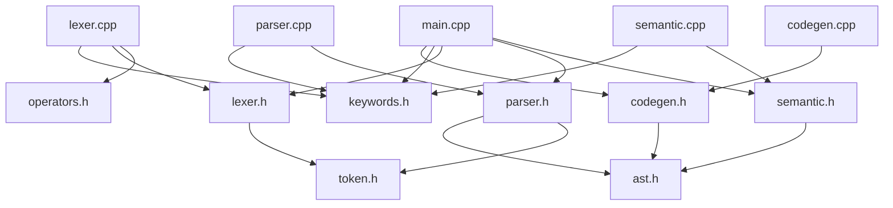
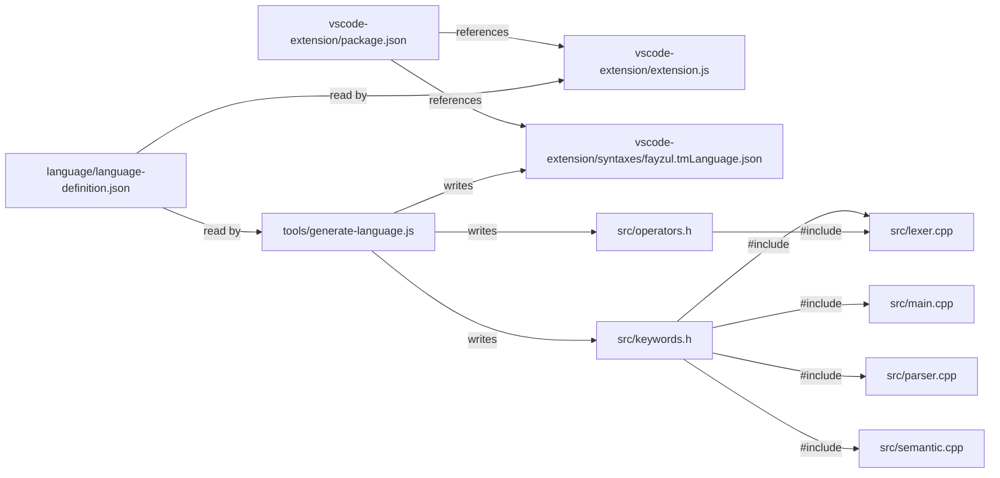

# FayZul Codebase Graph

> Generated by `tools/generate-codebase-graph.js` from the source code. Do not edit by hand; regenerate with
> `node tools/generate-codebase-graph.js`.

- Interactive graph: [CODEBASE_GRAPH.html](CODEBASE_GRAPH.html) (open in a browser; works offline)
- Machine-readable data: [CODEBASE_GRAPH.json](CODEBASE_GRAPH.json)
- Generator: [`tools/generate-codebase-graph.js`](../tools/generate-codebase-graph.js)

Every relationship in this document and in the graph was extracted from the code and carries evidence
(file, line, and source text). 1108 edges connect 447 nodes across 184 analyzed files; 37 edges are marked *heuristic* (text matching, see
[How the graph is built](#9-how-the-graph-is-built)).

## Contents

1. [Overview](#1-overview)
2. [Compiler pipeline](#2-compiler-pipeline)
3. [Module dependencies](#3-module-dependencies)
4. [Components](#4-components)
5. [AST data model](#5-ast-data-model)
6. [Language vocabulary](#6-language-vocabulary)
7. [Tests](#7-tests)
8. [VS Code extension](#8-vs-code-extension)
9. [How the graph is built](#9-how-the-graph-is-built)
10. [Graph data format](#10-graph-data-format)
11. [Coverage and limitations](#11-coverage-and-limitations)

## 1. Overview

FayZul is compiled by a C++17 program in `src/`: a lexer, a recursive-descent parser that builds an AST,
a semantic analyzer, and a code generator that emits C++17. `src/main.cpp` drives these stages, writes
the generated C++ to `build/`, compiles it with g++, and runs the result. The FayZul vocabulary lives in
one JSON file; a Node.js tool generates the C++ macro headers and the VS Code grammar from it.

| Layer | Files | Role |
|---|---|---|
| Language definition | [`language/language-definition.json`](../language/language-definition.json) | The single source of truth for FayZul words: keywords, word operators, arithmetic symbols. |
| Generation tools | [`tools/generate-codebase-graph.js`](../tools/generate-codebase-graph.js)<br>[`tools/generate-language.js`](../tools/generate-language.js) | Node.js scripts that generate headers, the TextMate grammar, and this graph. |
| Generated vocabulary | [`src/keywords.h`](../src/keywords.h)<br>[`src/operators.h`](../src/operators.h) | C++ macro headers generated from the language definition (do not edit by hand). |
| 1 · Lexing | [`src/token.h`](../src/token.h)<br>[`src/lexer.h`](../src/lexer.h)<br>[`src/lexer.cpp`](../src/lexer.cpp) | Characters to tokens (TokenType, Token, Lexer). |
| 2 · Parsing & AST | [`src/ast.h`](../src/ast.h)<br>[`src/parser.h`](../src/parser.h)<br>[`src/parser.cpp`](../src/parser.cpp) | Tokens to the abstract syntax tree (recursive descent). |
| 3 · Semantic analysis | [`src/semantic.h`](../src/semantic.h)<br>[`src/semantic.cpp`](../src/semantic.cpp) | Scope, loop, function, and return checks on the AST. |
| 4 · C++ generation | [`src/codegen.h`](../src/codegen.h)<br>[`src/codegen.cpp`](../src/codegen.cpp) | AST to C++17 source text plus a C++-line to FayZul-line map. |
| 5 · Compiler driver | [`src/main.cpp`](../src/main.cpp) | CLI entry point: runs every stage, invokes g++, runs the program, maps g++ errors. |
| 6 · Build & execution | 7 nodes | Files and processes produced at compile and run time. |
| FayZul programs | [`examples/functions.fz`](../examples/functions.fz)<br>[`examples/hello.fz`](../examples/hello.fz) | Example .fz programs (also run as smoke tests). |
| Regression tests | [`tests/run-tests.js`](../tests/run-tests.js) | Test runner and .fz cases with expected output (.out) or errors (.err). |
| VS Code extension | [`.vscode/launch.json`](../.vscode/launch.json)<br>[`vscode-extension/extension.js`](../vscode-extension/extension.js)<br>[`vscode-extension/language-configuration.json`](../vscode-extension/language-configuration.json)<br>[`vscode-extension/package.json`](../vscode-extension/package.json)<br>[`vscode-extension/syntaxes/fayzul.tmLanguage.json`](../vscode-extension/syntaxes/fayzul.tmLanguage.json) | Syntax highlighting, completion, and hover for .fz files. |
| Docs & project files | [`.gitignore`](../.gitignore)<br>[`README.md`](../README.md)<br>[`docs/FayZul_Development_Roadmap.md`](../docs/FayZul_Development_Roadmap.md)<br>[`docs/FayZul_Mindmap.md`](../docs/FayZul_Mindmap.md) | Documentation and repository configuration. |
| External | 20 external dependencies | Standard library headers, Node.js modules, the VS Code API, and g++. |

## 2. Compiler pipeline

The stages below are the order in which `main()` in [`src/main.cpp`](../src/main.cpp) runs them. Each arrow
was verified against the line cited in the table; the generator drops (and reports) any step whose code changed.

```mermaid
flowchart LR
    n0[/"FayZul source (*.fz)"/]
    n1["readFile"]
    n2["Lexer::Lexer"]
    n3["Lexer::tokenize"]
    n4[/"Token stream"/]
    n5["Parser::Parser"]
    n6["Parser::parse"]
    n7[("ProgramNode")]
    n8["SemanticAnalyzer::analyze"]
    n9["CodeGenerator::generate"]
    n10[/"Generated C++17 text"/]
    n11["writeFile"]
    n12[/"build/&lt;name&gt;.cpp"/]
    n13{{"g++"}}
    n14[/"build/&lt;name&gt;.exe"/]
    n15[/"build/&lt;name&gt;.gpp.log"/]
    n16["reportCppErrors"]
    n17[/"Program output"/]
    n0 -->|"read argv[1]"| n1
    n1 -->|"source text"| n2
    n2 -->|"lexer.tokenize()"| n3
    n3 -->|"returns"| n4
    n4 -->|"std::move(tokens)"| n5
    n5 -->|"parser.parse()"| n6
    n6 -->|"AST root"| n7
    n7 -->|"check *ast"| n8
    n8 -->|"no error thrown"| n9
    n7 -->|"lower *ast"| n9
    n9 -->|"returns"| n10
    n10 -->|"cppSource"| n11
    n11 -->|"writes"| n12
    n12 -->|"g++ -std=c++17 -pedantic-errors"| n13
    n13 -->|"-o"| n14
    n13 -->|"stderr (2&gt;)"| n15
    n15 -->|"on compile failure"| n16
    n14 -->|"std::system(runCmd)"| n17
```



| # | From | Step | To | Evidence |
|---:|---|---|---|---|
| 1 | FayZul source (*.fz) | read argv[1] | readFile | [main.cpp:158](../src/main.cpp#L158), [main.cpp:163](../src/main.cpp#L163) |
| 2 | readFile | source text | Lexer::Lexer | [main.cpp:172](../src/main.cpp#L172) |
| 3 | Lexer::Lexer | lexer.tokenize() | Lexer::tokenize | [main.cpp:173](../src/main.cpp#L173) |
| 4 | Lexer::tokenize | returns | Token stream | [main.cpp:173](../src/main.cpp#L173) |
| 5 | Token stream | std::move(tokens) | Parser::Parser | [main.cpp:182](../src/main.cpp#L182) |
| 6 | Parser::Parser | parser.parse() | Parser::parse | [main.cpp:183](../src/main.cpp#L183) |
| 7 | Parser::parse | AST root | ProgramNode | [main.cpp:180](../src/main.cpp#L180), [main.cpp:183](../src/main.cpp#L183) |
| 8 | ProgramNode | check *ast | SemanticAnalyzer::analyze | [main.cpp:192](../src/main.cpp#L192) |
| 9 | SemanticAnalyzer::analyze | no error thrown | CodeGenerator::generate | [main.cpp:192](../src/main.cpp#L192), [main.cpp:203](../src/main.cpp#L203) |
| 10 | ProgramNode | lower *ast | CodeGenerator::generate | [main.cpp:203](../src/main.cpp#L203) |
| 11 | CodeGenerator::generate | returns | Generated C++17 text | [main.cpp:203](../src/main.cpp#L203) |
| 12 | Generated C++17 text | cppSource | writeFile | [main.cpp:225](../src/main.cpp#L225) |
| 13 | writeFile | writes | build/<name>.cpp | [main.cpp:219](../src/main.cpp#L219), [main.cpp:225](../src/main.cpp#L225) |
| 14 | build/<name>.cpp | g++ -std=c++17 -pedantic-errors | g++ | [main.cpp:237](../src/main.cpp#L237), [main.cpp:245](../src/main.cpp#L245) |
| 15 | g++ | -o | build/<name>.exe | [main.cpp:220](../src/main.cpp#L220) |
| 16 | g++ | stderr (2>) | build/<name>.gpp.log | [main.cpp:221](../src/main.cpp#L221), [main.cpp:245](../src/main.cpp#L245) |
| 17 | build/<name>.gpp.log | on compile failure | reportCppErrors | [main.cpp:247](../src/main.cpp#L247) |
| 18 | build/<name>.exe | std::system(runCmd) | Program output | [main.cpp:259](../src/main.cpp#L259) |

**Values passed between components** (a value returned by one call and passed into another, found in the code):

| Producer | Value | Consumer | Evidence |
|---|---|---|---|
| readFile | `source` | Lexer::Lexer | [main.cpp:163](../src/main.cpp#L163), [main.cpp:172](../src/main.cpp#L172) |
| CodeGenerator::generate | `cppSource` | writeFile | [main.cpp:203](../src/main.cpp#L203), [main.cpp:225](../src/main.cpp#L225) |
| CodeGenerator::lineMap | `lineMap` | reportCppErrors | [main.cpp:204](../src/main.cpp#L204), [main.cpp:247](../src/main.cpp#L247) |
| Lexer::tokenize | `tokens` | Parser::Parser | [main.cpp:173](../src/main.cpp#L173), [main.cpp:182](../src/main.cpp#L182) |
| Parser::parse | `ast` | CodeGenerator::generate | [main.cpp:183](../src/main.cpp#L183), [main.cpp:203](../src/main.cpp#L203) |
| Parser::parse | `ast` | SemanticAnalyzer::analyze | [main.cpp:183](../src/main.cpp#L183), [main.cpp:192](../src/main.cpp#L192) |

**Error path.** Every stage reports the first error and stops. These functions throw `std::runtime_error` or print
to stderr; `main()` catches each stage's exception and prints it:

| Function | How | Message prefix | Evidence |
|---|---|---|---|
| main | prints to stderr |  | [main.cpp:154](../src/main.cpp#L154), [main.cpp:165](../src/main.cpp#L165), [main.cpp:175](../src/main.cpp#L175) (+4) |
| readFile | throws |  | [main.cpp:47](../src/main.cpp#L47) |
| reportCppErrors | prints to stderr | `[C++ Error]` `[FayZul]` | [main.cpp:138](../src/main.cpp#L138), [main.cpp:143](../src/main.cpp#L143), [main.cpp:145](../src/main.cpp#L145) |
| writeFile | throws |  | [main.cpp:60](../src/main.cpp#L60) |
| CodeGenerator::codegenError | throws | `[CodeGen Error]` | [codegen.cpp:452](../src/codegen.cpp#L452) |
| Lexer::lexError | throws | `[Lexer Error]` | [lexer.cpp:291](../src/lexer.cpp#L291) |
| Parser::parseError | throws | `[Parser Error]` | [parser.cpp:777](../src/parser.cpp#L777) |
| SemanticAnalyzer::error | throws | `[Semantic Error]` | [semantic.cpp:587](../src/semantic.cpp#L587) |

## 3. Module dependencies

### C++ `#include` graph



| File | Includes (project) | Includes (standard library) |
|---|---|---|
| [`src/keywords.h`](../src/keywords.h) |  |  |
| [`src/operators.h`](../src/operators.h) |  |  |
| [`src/token.h`](../src/token.h) |  | `<string>` |
| [`src/lexer.h`](../src/lexer.h) | `token.h` | `<string>` `<unordered_map>` `<vector>` |
| [`src/lexer.cpp`](../src/lexer.cpp) | `keywords.h`, `lexer.h`, `operators.h` | `<cctype>` `<sstream>` `<stdexcept>` |
| [`src/ast.h`](../src/ast.h) |  | `<memory>` `<string>` `<vector>` |
| [`src/parser.h`](../src/parser.h) | `ast.h`, `token.h` | `<memory>` `<vector>` |
| [`src/parser.cpp`](../src/parser.cpp) | `keywords.h`, `parser.h` | `<sstream>` `<stdexcept>` |
| [`src/semantic.h`](../src/semantic.h) | `ast.h` | `<map>` `<set>` `<string>` `<vector>` |
| [`src/semantic.cpp`](../src/semantic.cpp) | `keywords.h`, `semantic.h` | `<sstream>` `<stdexcept>` |
| [`src/codegen.h`](../src/codegen.h) | `ast.h` | `<string>` `<vector>` |
| [`src/codegen.cpp`](../src/codegen.cpp) | `codegen.h` | `<sstream>` `<stdexcept>` |
| [`src/main.cpp`](../src/main.cpp) | `codegen.h`, `keywords.h`, `lexer.h`, `parser.h`, `semantic.h` | `<cstdlib>` `<filesystem>` `<fstream>` `<iostream>` `<regex>` `<set>` `<sstream>` `<stdexcept>` `<string>` `<vector>` |

### Node.js modules

| File | require() | Reads | Writes | Executes |
|---|---|---|---|---|
| [`tools/generate-codebase-graph.js`](../tools/generate-codebase-graph.js) | `child_process`, `fs`, `os`, `path` | `.git/config`, `.gitignore` |  | `g++` |
| [`tools/generate-language.js`](../tools/generate-language.js) | `fs`, `path` | `language/language-definition.json` | `src/keywords.h`, `src/operators.h`, `vscode-extension/syntaxes/fayzul.tmLanguage.json`, `vscode-extension/syntaxes` |  |
| [`tests/run-tests.js`](../tests/run-tests.js) | `child_process`, `fs`, `os`, `path` | `build/fayzul.exe`, `src` | `build` | `build/fayzul.exe`, `g++` |
| [`vscode-extension/extension.js`](../vscode-extension/extension.js) | `fs`, `path`, `vscode` | `language/language-definition.json` |  |  |

## 4. Components

Calls are resolved statically: unqualified calls inside a class go to that class's methods, `obj.method()`
resolves when `obj` is a local of a project class, and free functions resolve through the include graph.
`--verify-gcc` compares the C++ part with g++'s own call graph.

### `Lexer` (1 · Lexing)

Declared in [`src/lexer.h:35`](../src/lexer.h#L35). FayZul Lexer Interface.

| Function | Defined | Calls | Called by |
|---|---|---|---|
| `Lexer()` | [lexer.cpp:35](../src/lexer.cpp#L35) |  | main |
| `tokenize()` | [lexer.cpp:71](../src/lexer.cpp#L71) | advance, isAtEnd, lexError, peek, readNumber, readString, readWordOrKeyword, skipWhitespaceAndComments | main |
| `skipWhitespaceAndComments()` | [lexer.cpp:137](../src/lexer.cpp#L137) | advance, isAtEnd, peek, peekNext | tokenize |
| `readString()` | [lexer.cpp:159](../src/lexer.cpp#L159) | advance, isAtEnd, lexError, peek | tokenize |
| `readNumber()` | [lexer.cpp:206](../src/lexer.cpp#L206) | advance, isAtEnd, peek, peekNext | tokenize |
| `readWordOrKeyword()` | [lexer.cpp:230](../src/lexer.cpp#L230) | advance, isAtEnd, peek | tokenize |
| `peek()` | [lexer.cpp:255](../src/lexer.cpp#L255) | isAtEnd | readNumber, readString, readWordOrKeyword, skipWhitespaceAndComments, tokenize |
| `peekNext()` | [lexer.cpp:260](../src/lexer.cpp#L260) |  | readNumber, skipWhitespaceAndComments |
| `advance()` | [lexer.cpp:265](../src/lexer.cpp#L265) |  | readNumber, readString, readWordOrKeyword, skipWhitespaceAndComments, tokenize |
| `isAtEnd()` | [lexer.cpp:276](../src/lexer.cpp#L276) |  | peek, readNumber, readString, readWordOrKeyword, skipWhitespaceAndComments, tokenize |
| `makeToken()` | [lexer.cpp:280](../src/lexer.cpp#L280) |  | — |
| `lexError()` | [lexer.cpp:287](../src/lexer.cpp#L287) |  | readString, tokenize |

### `Parser` (2 · Parsing & AST)

Declared in [`src/parser.h:65`](../src/parser.h#L65). FayZul Parser Interface.

| Function | Defined | Calls | Called by |
|---|---|---|---|
| `Parser()` | [parser.cpp:28](../src/parser.cpp#L28) |  | main |
| `parse()` | [parser.cpp:34](../src/parser.cpp#L34) | check, isAtEnd, parseFunctionDecl, parseStatement | main |
| `parseStatement()` | [parser.cpp:52](../src/parser.cpp#L52) | current, isCallStatement, parseAssignStatement, parseBreakStatement, parseCallStatement, parseContinueStatement, parseError, parseIfStatement, parsePrintStatement, parseReturnStatement, parseVarDeclStatement, parseWhileStatement | parse, parseBlock |
| `parsePrintStatement()` | [parser.cpp:113](../src/parser.cpp#L113) | check, consume, current, expect, parseExpression | parseStatement |
| `parseVarDeclStatement()` | [parser.cpp:158](../src/parser.cpp#L158) | consume, current, expect, parseExpression | parseStatement |
| `parseAssignStatement()` | [parser.cpp:191](../src/parser.cpp#L191) | afterMatchingParen, check, consume, current, expect, parseError, parseExpression | parseStatement |
| `parseIfStatement()` | [parser.cpp:232](../src/parser.cpp#L232) | check, consume, current, expect, parseBlock, parseExpression | parseStatement |
| `parseWhileStatement()` | [parser.cpp:266](../src/parser.cpp#L266) | consume, current, expect, parseBlock, parseExpression | parseStatement |
| `parseBreakStatement()` | [parser.cpp:292](../src/parser.cpp#L292) | consume, current, expect | parseStatement |
| `parseContinueStatement()` | [parser.cpp:309](../src/parser.cpp#L309) | consume, current, expect | parseStatement |
| `parseBlock()` | [parser.cpp:329](../src/parser.cpp#L329) | check, current, expect, isAtEnd, parseStatement | parseFunctionDecl, parseIfStatement, parseWhileStatement |
| `parseFunctionDecl()` | [parser.cpp:358](../src/parser.cpp#L358) | check, consume, current, expect, match, parseBlock | parse |
| `parseReturnStatement()` | [parser.cpp:401](../src/parser.cpp#L401) | check, consume, current, expect, parseExpression | parseStatement |
| `afterMatchingParen()` | [parser.cpp:425](../src/parser.cpp#L425) |  | isCallStatement, parseAssignStatement |
| `isCallStatement()` | [parser.cpp:453](../src/parser.cpp#L453) | afterMatchingParen, peek | parseStatement |
| `parseCallStatement()` | [parser.cpp:471](../src/parser.cpp#L471) | current, expect, parseCallExpr | parseStatement |
| `parseCallExpr()` | [parser.cpp:490](../src/parser.cpp#L490) | check, consume, expect, match, parseExpression | parseCallStatement, parsePrimary |
| `parseExpression()` | [parser.cpp:516](../src/parser.cpp#L516) | parseLogicalOr | parseAssignStatement, parseCallExpr, parseIfStatement, parsePrimary, parsePrintStatement, parseReturnStatement, parseVarDeclStatement, parseWhileStatement |
| `parseLogicalOr()` | [parser.cpp:525](../src/parser.cpp#L525) | check, consume, parseLogicalAnd | parseExpression |
| `parseLogicalAnd()` | [parser.cpp:545](../src/parser.cpp#L545) | check, consume, parseLogicalNot | parseLogicalOr |
| `parseLogicalNot()` | [parser.cpp:567](../src/parser.cpp#L567) | check, consume, parseComparison, parseLogicalNot | parseLogicalAnd, parseLogicalNot |
| `parseComparison()` | [parser.cpp:587](../src/parser.cpp#L587) | consume, current, parseAdditive | parseLogicalNot |
| `parseAdditive()` | [parser.cpp:624](../src/parser.cpp#L624) | check, consume, parseTerm | parseComparison |
| `parseTerm()` | [parser.cpp:643](../src/parser.cpp#L643) | check, consume, parsePrimary | parseAdditive |
| `parsePrimary()` | [parser.cpp:663](../src/parser.cpp#L663) | consume, current, expect, parseCallExpr, parseError, parseExpression, peek | parseTerm |
| `current()` | [parser.cpp:727](../src/parser.cpp#L727) |  | check, expect, parseAssignStatement, parseBlock, parseBreakStatement, parseCallStatement, parseComparison, parseContinueStatement, parseError, parseFunctionDecl, parseIfStatement, parsePrimary, parsePrintStatement, parseReturnStatement, parseStatement, parseVarDeclStatement, parseWhileStatement |
| `peek()` | [parser.cpp:732](../src/parser.cpp#L732) |  | isCallStatement, parsePrimary |
| `consume()` | [parser.cpp:740](../src/parser.cpp#L740) | isAtEnd | expect, match, parseAdditive, parseAssignStatement, parseBreakStatement, parseCallExpr, parseComparison, parseContinueStatement, parseFunctionDecl, parseIfStatement, parseLogicalAnd, parseLogicalNot, parseLogicalOr, parsePrimary, parsePrintStatement, parseReturnStatement, parseTerm, parseVarDeclStatement, parseWhileStatement |
| `expect()` | [parser.cpp:746](../src/parser.cpp#L746) | check, consume, current, parseError | parseAssignStatement, parseBlock, parseBreakStatement, parseCallExpr, parseCallStatement, parseContinueStatement, parseFunctionDecl, parseIfStatement, parsePrimary, parsePrintStatement, parseReturnStatement, parseVarDeclStatement, parseWhileStatement |
| `isAtEnd()` | [parser.cpp:753](../src/parser.cpp#L753) |  | consume, parse, parseBlock |
| `check()` | [parser.cpp:757](../src/parser.cpp#L757) | current | expect, match, parse, parseAdditive, parseAssignStatement, parseBlock, parseCallExpr, parseFunctionDecl, parseIfStatement, parseLogicalAnd, parseLogicalNot, parseLogicalOr, parsePrintStatement, parseReturnStatement, parseTerm |
| `match()` | [parser.cpp:761](../src/parser.cpp#L761) | check, consume | parseCallExpr, parseFunctionDecl |
| `parseError()` | [parser.cpp:772](../src/parser.cpp#L772) | current | expect, parseAssignStatement, parsePrimary, parseStatement |

### `SemanticAnalyzer` (3 · Semantic analysis)

Declared in [`src/semantic.h:47`](../src/semantic.h#L47). FayZul Semantic Analyzer Interface.

| Function | Defined | Calls | Called by |
|---|---|---|---|
| `analyze()` | [semantic.cpp:33](../src/semantic.cpp#L33) | checkFunction, checkStatement, collectFunctions, collectTopLevelVariables, computeRecursionGroups | main |
| `collectFunctions()` | [semantic.cpp:66](../src/semantic.cpp#L66) | collectCallees, error | analyze |
| `computeRecursionGroups()` | [semantic.cpp:89](../src/semantic.cpp#L89) |  | analyze |
| `collectTopLevelVariables()` | [semantic.cpp:111](../src/semantic.cpp#L111) | collectTopLevelVariables | analyze, collectTopLevelVariables |
| `checkFunction()` | [semantic.cpp:138](../src/semantic.cpp#L138) | checkRecursionOrder, checkReturnConsistency, checkStatement, definitelyReturns, error, quote | analyze |
| `checkReturnConsistency()` | [semantic.cpp:187](../src/semantic.cpp#L187) | checkReturnConsistency, error | checkFunction, checkReturnConsistency |
| `checkRecursionOrder()` | [semantic.cpp:231](../src/semantic.cpp#L231) | recursionOrderStmt | checkFunction |
| `recursionOrderStmt()` | [semantic.cpp:237](../src/semantic.cpp#L237) | recursionOrderExpr, recursionOrderStmt | checkRecursionOrder, recursionOrderStmt |
| `recursionOrderExpr()` | [semantic.cpp:287](../src/semantic.cpp#L287) | error, quote, recursionOrderExpr | recursionOrderExpr, recursionOrderStmt |
| `checkStatement()` | [semantic.cpp:323](../src/semantic.cpp#L323) | checkBlock, checkCall, checkExpr, declareVariable, error, isVariable, quote | analyze, checkBlock, checkFunction |
| `checkBlock()` | [semantic.cpp:405](../src/semantic.cpp#L405) | checkStatement | checkStatement |
| `checkExpr()` | [semantic.cpp:416](../src/semantic.cpp#L416) | checkCall, checkExpr, error, isVariable | checkCall, checkExpr, checkStatement |
| `checkCall()` | [semantic.cpp:462](../src/semantic.cpp#L462) | checkExpr, error, isVariable, quote | checkExpr, checkStatement |
| `isVariable()` | [semantic.cpp:489](../src/semantic.cpp#L489) |  | checkCall, checkExpr, checkStatement |
| `declareVariable()` | [semantic.cpp:496](../src/semantic.cpp#L496) | error | checkStatement |
| `definitelyReturns()` | [semantic.cpp:511](../src/semantic.cpp#L511) | definitelyReturns | checkFunction, definitelyReturns |
| `collectCallees()` | [semantic.cpp:529](../src/semantic.cpp#L529) | collectCallees | collectCallees, collectFunctions |
| `error()` | [semantic.cpp:584](../src/semantic.cpp#L584) | error | checkCall, checkExpr, checkFunction, checkReturnConsistency, checkStatement, collectFunctions, declareVariable, error, recursionOrderExpr |

### `CodeGenerator` (4 · C++ generation)

Declared in [`src/codegen.h:36`](../src/codegen.h#L36). FayZul C++ Code Generator Interface.

| Function | Defined | Calls | Called by |
|---|---|---|---|
| `generate()` | [codegen.cpp:57](../src/codegen.cpp#L57) | emitLine, functionSignature, generateFunctionDecl, generateNode, indent | main |
| `generateNode()` | [codegen.cpp:113](../src/codegen.cpp#L113) | codegenError, generateAssign, generateBreakStmt, generateCallStmt, generateContinueStmt, generateIfStmt, generatePrintStmt, generateReturnStmt, generateVarDecl, generateWhileStmt | generate, generateBlock |
| `functionSignature()` | [codegen.cpp:167](../src/codegen.cpp#L167) | cppName | generate, generateFunctionDecl |
| `generateFunctionDecl()` | [codegen.cpp:182](../src/codegen.cpp#L182) | emitLine, functionSignature, generateBlock | generate |
| `generatePrintStmt()` | [codegen.cpp:205](../src/codegen.cpp#L205) | emitLine, generateExpr, indent | generateNode |
| `generateVarDecl()` | [codegen.cpp:233](../src/codegen.cpp#L233) | cppName, emitLine, generateExpr, indent | generateNode |
| `generateAssign()` | [codegen.cpp:242](../src/codegen.cpp#L242) | cppName, emitLine, generateExpr, indent | generateNode |
| `generateIfStmt()` | [codegen.cpp:256](../src/codegen.cpp#L256) | emitLine, generateBlock, generateExpr, indent | generateNode |
| `generateWhileStmt()` | [codegen.cpp:278](../src/codegen.cpp#L278) | emitLine, generateBlock, generateExpr, indent | generateNode |
| `generateBreakStmt()` | [codegen.cpp:293](../src/codegen.cpp#L293) | emitLine, indent | generateNode |
| `generateContinueStmt()` | [codegen.cpp:297](../src/codegen.cpp#L297) | emitLine, indent | generateNode |
| `generateReturnStmt()` | [codegen.cpp:305](../src/codegen.cpp#L305) | emitLine, generateExpr, indent | generateNode |
| `generateCallStmt()` | [codegen.cpp:317](../src/codegen.cpp#L317) | emitLine, generateExpr, indent | generateNode |
| `generateBlock()` | [codegen.cpp:326](../src/codegen.cpp#L326) | generateNode | generateFunctionDecl, generateIfStmt, generateWhileStmt |
| `generateExpr()` | [codegen.cpp:335](../src/codegen.cpp#L335) | codegenError, generateBinaryExpr, generateBoolLiteral, generateCallExpr, generateIdentifier, generateNullLiteral, generateNumberLiteral, generateStringLiteral, generateUnaryExpr | generateAssign, generateBinaryExpr, generateCallExpr, generateCallStmt, generateIfStmt, generatePrintStmt, generateReturnStmt, generateUnaryExpr, generateVarDecl, generateWhileStmt |
| `generateStringLiteral()` | [codegen.cpp:363](../src/codegen.cpp#L363) |  | generateExpr |
| `generateNumberLiteral()` | [codegen.cpp:380](../src/codegen.cpp#L380) |  | generateExpr |
| `generateBoolLiteral()` | [codegen.cpp:384](../src/codegen.cpp#L384) |  | generateExpr |
| `generateNullLiteral()` | [codegen.cpp:388](../src/codegen.cpp#L388) |  | generateExpr |
| `generateIdentifier()` | [codegen.cpp:392](../src/codegen.cpp#L392) | cppName | generateExpr |
| `generateBinaryExpr()` | [codegen.cpp:402](../src/codegen.cpp#L402) | generateExpr | generateExpr |
| `generateUnaryExpr()` | [codegen.cpp:412](../src/codegen.cpp#L412) | generateExpr | generateExpr |
| `generateCallExpr()` | [codegen.cpp:422](../src/codegen.cpp#L422) | cppName, generateExpr | generateExpr |
| `cppName()` | [codegen.cpp:435](../src/codegen.cpp#L435) |  | functionSignature, generateAssign, generateCallExpr, generateIdentifier, generateVarDecl |
| `indent()` | [codegen.cpp:439](../src/codegen.cpp#L439) |  | generate, generateAssign, generateBreakStmt, generateCallStmt, generateContinueStmt, generateIfStmt, generatePrintStmt, generateReturnStmt, generateVarDecl, generateWhileStmt |
| `emitLine()` | [codegen.cpp:443](../src/codegen.cpp#L443) |  | generate, generateAssign, generateBreakStmt, generateCallStmt, generateContinueStmt, generateFunctionDecl, generateIfStmt, generatePrintStmt, generateReturnStmt, generateVarDecl, generateWhileStmt |
| `codegenError()` | [codegen.cpp:448](../src/codegen.cpp#L448) |  | generateExpr, generateNode |
| `lineMap()` | [codegen.h:44](../src/codegen.h#L44) |  | main |

### `tools/generate-codebase-graph.js`

Builds a dependency graph of the FayZul repository from its source code.

| Function | Defined | Calls | Called by |
|---|---|---|---|
| `rel()` | [generate-codebase-graph.js:211](../tools/generate-codebase-graph.js#L211) |  | generate-codebase-graph.js, labelToId, main, walk |
| `layerOf()` | [generate-codebase-graph.js:215](../tools/generate-codebase-graph.js#L215) |  | analyzeCppStructure, analyzeJs, analyzeJsonReferences, analyzeLanguageDefinition, analyzeTests, buildGraph, defineFunction, onBlock, onDecl, resolvePathNode |
| `sortedUnique()` | [generate-codebase-graph.js:222](../tools/generate-codebase-graph.js#L222) |  | analyzeCppBodies, componentTable, onDecl, projectTypesIn, renderMarkdown |
| `loadIgnorePatterns()` | [generate-codebase-graph.js:231](../tools/generate-codebase-graph.js#L231) |  | discoverFiles |
| `isIgnored()` | [generate-codebase-graph.js:245](../tools/generate-codebase-graph.js#L245) |  | walk |
| `discoverFiles()` | [generate-codebase-graph.js:250](../tools/generate-codebase-graph.js#L250) | loadIgnorePatterns, walk | buildGraph |
| `walk()` | [generate-codebase-graph.js:255](../tools/generate-codebase-graph.js#L255) | isBinary, isIgnored, makeFile, rel, walk | discoverFiles, walk |
| `isBinary()` | [generate-codebase-graph.js:290](../tools/generate-codebase-graph.js#L290) |  | walk |
| `makeFile()` | [generate-codebase-graph.js:295](../tools/generate-codebase-graph.js#L295) |  | walk |
| `lineOf()` | [generate-codebase-graph.js:310](../tools/generate-codebase-graph.js#L310) |  | addPipeline, analyzeCppBodies, analyzeCppStructure, analyzeJs, defineFunction, onBlock, onDecl |
| `evidence()` | [generate-codebase-graph.js:319](../tools/generate-codebase-graph.js#L319) |  | addPipeline, analyzeCppBodies, analyzeCppStructure, analyzeJs, analyzeJsonReferences, analyzeMarkdown, linkExpectedErrors, linkTermsToMacros, linkVsCodeActivation, recordCall, resolveCppPending, visit |
| `unescapeChar()` | [generate-codebase-graph.js:328](../tools/generate-codebase-graph.js#L328) |  | readQuoted |
| `lexSource()` | [generate-codebase-graph.js:332](../tools/generate-codebase-graph.js#L332) | lexCode | analyzeCppStructure, analyzeJs, fayzulTermsUsed |
| `blank()` | [generate-codebase-graph.js:339](../tools/generate-codebase-graph.js#L339) |  | lexCode, readQuoted, readRegex, readTemplate |
| `regexAllowed()` | [generate-codebase-graph.js:343](../tools/generate-codebase-graph.js#L343) |  | lexCode |
| `readQuoted()` | [generate-codebase-graph.js:356](../tools/generate-codebase-graph.js#L356) | blank, unescapeChar | lexCode |
| `readTemplate()` | [generate-codebase-graph.js:369](../tools/generate-codebase-graph.js#L369) | blank, lexCode | lexCode |
| `readRegex()` | [generate-codebase-graph.js:388](../tools/generate-codebase-graph.js#L388) | blank | lexCode |
| `lexCode()` | [generate-codebase-graph.js:406](../tools/generate-codebase-graph.js#L406) | blank, readQuoted, readRegex, readTemplate, regexAllowed | lexSource, readTemplate |
| `tokenize()` | [generate-codebase-graph.js:445](../tools/generate-codebase-graph.js#L445) |  | analyzeCppBodies, analyzeJs |
| `matchBrace()` | [generate-codebase-graph.js:467](../tools/generate-codebase-graph.js#L467) |  | defineFunction, onDecl, scan |
| `matchToken()` | [generate-codebase-graph.js:478](../tools/generate-codebase-graph.js#L478) |  | analyzeCppBodies, analyzeJs, evalPath, firstArgPath |
| `skipTemplateArgs()` | [generate-codebase-graph.js:491](../tools/generate-codebase-graph.js#L491) |  | analyzeCppBodies |
| `constructor()` | [generate-codebase-graph.js:509](../tools/generate-codebase-graph.js#L509) |  | buildGraph |
| `node()` | [generate-codebase-graph.js:515](../tools/generate-codebase-graph.js#L515) |  | buildGraph |
| `has()` | [generate-codebase-graph.js:529](../tools/generate-codebase-graph.js#L529) |  | — |
| `edge()` | [generate-codebase-graph.js:535](../tools/generate-codebase-graph.js#L535) |  | — |
| `stripAccessLabels()` | [generate-codebase-graph.js:560](../tools/generate-codebase-graph.js#L560) |  | onBlock, onDecl |
| `fileId()` | [generate-codebase-graph.js:564](../tools/generate-codebase-graph.js#L564) |  | analyzeCppStructure, analyzeJs, analyzeJsonReferences, analyzeLanguageDefinition, analyzeMarkdown, buildGraph, defineFunction, onBlock, onDecl, resolvePathNode, visit |
| `fileSummary()` | [generate-codebase-graph.js:566](../tools/generate-codebase-graph.js#L566) |  | buildGraph |
| `analyzeCppStructure()` | [generate-codebase-graph.js:586](../tools/generate-codebase-graph.js#L586) | evidence, fileId, layerOf, lexSource, lineOf, scan | buildGraph |
| `scan()` | [generate-codebase-graph.js:627](../tools/generate-codebase-graph.js#L627) | matchBrace, onBlock, onDecl | analyzeCppStructure, onBlock |
| `onBlock()` | [generate-codebase-graph.js:646](../tools/generate-codebase-graph.js#L646) | defineFunction, fileId, layerOf, lineOf, scan, stripAccessLabels | scan |
| `defineFunction()` | [generate-codebase-graph.js:683](../tools/generate-codebase-graph.js#L683) | addSignature, fileId, layerOf, lineOf, matchBrace | onBlock |
| `onDecl()` | [generate-codebase-graph.js:741](../tools/generate-codebase-graph.js#L741) | fileId, layerOf, lineOf, matchBrace, sortedUnique, stripAccessLabels | scan |
| `addSignature()` | [generate-codebase-graph.js:804](../tools/generate-codebase-graph.js#L804) |  | defineFunction |
| `projectTypesIn()` | [generate-codebase-graph.js:815](../tools/generate-codebase-graph.js#L815) | sortedUnique | analyzeCppBodies, resolveCppPending |
| `resolveCppPending()` | [generate-codebase-graph.js:820](../tools/generate-codebase-graph.js#L820) | evidence, projectTypesIn | buildGraph |
| `includeClosure()` | [generate-codebase-graph.js:857](../tools/generate-codebase-graph.js#L857) | includeClosure | analyzeCppBodies, includeClosure |
| `analyzeCppBodies()` | [generate-codebase-graph.js:869](../tools/generate-codebase-graph.js#L869) | evidence, includeClosure, lineOf, matchToken, projectTypesIn, recordCall, resolveFree, skipTemplateArgs, sortedUnique, tokenize | buildGraph |
| `resolveFree()` | [generate-codebase-graph.js:891](../tools/generate-codebase-graph.js#L891) |  | analyzeCppBodies |
| `recordCall()` | [generate-codebase-graph.js:927](../tools/generate-codebase-graph.js#L927) | evidence | analyzeCppBodies |
| `analyzeJs()` | [generate-codebase-graph.js:1072](../tools/generate-codebase-graph.js#L1072) | enclosing, evalPath, evidence, fileId, firstArgPath, layerOf, lexSource, lineOf, matchToken, resolvePathNode, scopeChain, tokenize | buildGraph |
| `enclosing()` | [generate-codebase-graph.js:1165](../tools/generate-codebase-graph.js#L1165) |  | analyzeJs |
| `scopeChain()` | [generate-codebase-graph.js:1219](../tools/generate-codebase-graph.js#L1219) |  | analyzeJs |
| `evalPath()` | [generate-codebase-graph.js:1240](../tools/generate-codebase-graph.js#L1240) | evalPath, matchToken | analyzeJs, evalPath, firstArgPath |
| `firstArgPath()` | [generate-codebase-graph.js:1291](../tools/generate-codebase-graph.js#L1291) | evalPath, matchToken | analyzeJs |
| `resolvePathNode()` | [generate-codebase-graph.js:1486](../tools/generate-codebase-graph.js#L1486) | fileId, layerOf | analyzeJs, analyzeMarkdown, visit |
| `findLine()` | [generate-codebase-graph.js:1508](../tools/generate-codebase-graph.js#L1508) |  | analyzeJsonReferences, analyzeLanguageDefinition, visit |
| `analyzeLanguageDefinition()` | [generate-codebase-graph.js:1513](../tools/generate-codebase-graph.js#L1513) | fileId, findLine, layerOf | buildGraph |
| `linkTermsToMacros()` | [generate-codebase-graph.js:1547](../tools/generate-codebase-graph.js#L1547) | evidence | buildGraph |
| `analyzeJsonReferences()` | [generate-codebase-graph.js:1562](../tools/generate-codebase-graph.js#L1562) | evidence, fileId, findLine, layerOf, visit | buildGraph |
| `visit()` | [generate-codebase-graph.js:1569](../tools/generate-codebase-graph.js#L1569) | evidence, fileId, findLine, resolvePathNode, visit | analyzeJsonReferences, visit |
| `linkVsCodeActivation()` | [generate-codebase-graph.js:1607](../tools/generate-codebase-graph.js#L1607) | evidence | buildGraph |
| `analyzeMarkdown()` | [generate-codebase-graph.js:1621](../tools/generate-codebase-graph.js#L1621) | evidence, fileId, resolvePathNode | buildGraph |
| `fayzulTermsUsed()` | [generate-codebase-graph.js:1635](../tools/generate-codebase-graph.js#L1635) | lexSource | analyzeTests |
| `analyzeTests()` | [generate-codebase-graph.js:1642](../tools/generate-codebase-graph.js#L1642) | fayzulTermsUsed, fileSummaryFz, layerOf, linkExpectedErrors | buildGraph |
| `fileSummaryFz()` | [generate-codebase-graph.js:1686](../tools/generate-codebase-graph.js#L1686) |  | analyzeTests |
| `linkExpectedErrors()` | [generate-codebase-graph.js:1693](../tools/generate-codebase-graph.js#L1693) | evidence, literalOwners | analyzeTests |
| `literalOwners()` | [generate-codebase-graph.js:1730](../tools/generate-codebase-graph.js#L1730) |  | linkExpectedErrors |
| `addPipeline()` | [generate-codebase-graph.js:1744](../tools/generate-codebase-graph.js#L1744) | evidence, lineOf, main | buildGraph |
| `buildGraph()` | [generate-codebase-graph.js:1782](../tools/generate-codebase-graph.js#L1782) | Graph.constructor, Graph.node, addPipeline, analyzeCppBodies, analyzeCppStructure, analyzeJs, analyzeJsonReferences, analyzeLanguageDefinition, analyzeMarkdown, analyzeTests, discoverFiles, fileId, fileSummary, layerOf, linkTermsToMacros, linkVsCodeActivation, resolveCppPending | renderOutputs |
| `verifyWithGcc()` | [generate-codebase-graph.js:1832](../tools/generate-codebase-graph.js#L1832) | labelToId, toIdHas | main |
| `labelToId()` | [generate-codebase-graph.js:1841](../tools/generate-codebase-graph.js#L1841) | rel | verifyWithGcc |
| `toIdHas()` | [generate-codebase-graph.js:1879](../tools/generate-codebase-graph.js#L1879) |  | verifyWithGcc |
| `renderHtml()` | [generate-codebase-graph.js:1889](../tools/generate-codebase-graph.js#L1889) |  | renderOutputs |
| `sentence()` | [generate-codebase-graph.js:2789](../tools/generate-codebase-graph.js#L2789) |  | renderMarkdown |
| `renderMarkdown()` | [generate-codebase-graph.js:2793](../tools/generate-codebase-graph.js#L2793) | componentTable, fileOf, mid, sentence, short, sortedUnique | renderOutputs |
| `short()` | [generate-codebase-graph.js:2801](../tools/generate-codebase-graph.js#L2801) |  | componentTable, renderMarkdown |
| `mid()` | [generate-codebase-graph.js:2811](../tools/generate-codebase-graph.js#L2811) |  | renderMarkdown |
| `componentTable()` | [generate-codebase-graph.js:2919](../tools/generate-codebase-graph.js#L2919) | short, sortedUnique | renderMarkdown |
| `fileOf()` | [generate-codebase-graph.js:2979](../tools/generate-codebase-graph.js#L2979) |  | renderMarkdown |
| `edgeLabel()` | [generate-codebase-graph.js:3130](../tools/generate-codebase-graph.js#L3130) |  | exportGraph |
| `repositoryUrl()` | [generate-codebase-graph.js:3158](../tools/generate-codebase-graph.js#L3158) |  | exportGraph |
| `includeRank()` | [generate-codebase-graph.js:3170](../tools/generate-codebase-graph.js#L3170) | includeRank | groupKey, includeRank |
| `exportGraph()` | [generate-codebase-graph.js:3178](../tools/generate-codebase-graph.js#L3178) | count, edgeLabel, repositoryUrl, sortKey | renderOutputs |
| `groupKey()` | [generate-codebase-graph.js:3185](../tools/generate-codebase-graph.js#L3185) | includeRank | sortKey |
| `sortKey()` | [generate-codebase-graph.js:3192](../tools/generate-codebase-graph.js#L3192) | groupKey | exportGraph |
| `count()` | [generate-codebase-graph.js:3239](../tools/generate-codebase-graph.js#L3239) |  | exportGraph |
| `validateGraph()` | [generate-codebase-graph.js:3276](../tools/generate-codebase-graph.js#L3276) |  | renderOutputs |
| `renderOutputs()` | [generate-codebase-graph.js:3324](../tools/generate-codebase-graph.js#L3324) | buildGraph, exportGraph, renderHtml, renderMarkdown, validateGraph | main |
| `main()` | [generate-codebase-graph.js:3339](../tools/generate-codebase-graph.js#L3339) | rel, renderOutputs, verifyWithGcc | addPipeline, generate-codebase-graph.js |

### `tools/generate-language.js`

Reads language/language-definition.json (the single FayZul vocabulary).

| Function | Defined | Calls | Called by |
|---|---|---|---|
| `loadDefinition()` | [generate-language.js:21](../tools/generate-language.js#L21) |  | main |
| `padMacro()` | [generate-language.js:26](../tools/generate-language.js#L26) |  | generateKeywordsH, generateOperatorsH |
| `generateKeywordsH()` | [generate-language.js:30](../tools/generate-language.js#L30) | padMacro | main |
| `generateOperatorsH()` | [generate-language.js:60](../tools/generate-language.js#L60) | padMacro | main |
| `alt()` | [generate-language.js:88](../tools/generate-language.js#L88) |  | generateTmLanguage |
| `generateTmLanguage()` | [generate-language.js:94](../tools/generate-language.js#L94) | alt | main |
| `main()` | [generate-language.js:196](../tools/generate-language.js#L196) | generateKeywordsH, generateOperatorsH, generateTmLanguage, loadDefinition | generate-language.js |

### `src/token.h`

FayZul Token Types and Token Structure.

| Function | Defined | Calls | Called by |
|---|---|---|---|
| `tokenTypeName()` | [token.h:96](../src/token.h#L96) |  | — |

### `src/semantic.cpp`

FayZul Semantic Analyzer Implementation.

| Function | Defined | Calls | Called by |
|---|---|---|---|
| `quote()` | [semantic.cpp:27](../src/semantic.cpp#L27) |  | checkCall, checkFunction, checkStatement, recursionOrderExpr |

### `src/main.cpp`

FayZul Compiler Driver — CLI Entry Point.

| Function | Defined | Calls | Called by |
|---|---|---|---|
| `readFile()` | [main.cpp:44](../src/main.cpp#L44) |  | main, reportCppErrors |
| `writeFile()` | [main.cpp:57](../src/main.cpp#L57) |  | main |
| `describeCppType()` | [main.cpp:68](../src/main.cpp#L68) |  | translateCppError |
| `translateCppError()` | [main.cpp:80](../src/main.cpp#L80) | describeCppType | reportCppErrors |
| `reportCppErrors()` | [main.cpp:109](../src/main.cpp#L109) | readFile, translateCppError | main |
| `main()` | [main.cpp:151](../src/main.cpp#L151) | Lexer, Parser, analyze, generate, lineMap, parse, readFile, reportCppErrors, tokenize, writeFile | — |

### `tests/run-tests.js`

FayZul regression test runner.

| Function | Defined | Calls | Called by |
|---|---|---|---|
| `normalize()` | [run-tests.js:38](../tests/run-tests.js#L38) |  | runCompiler, runTest |
| `findFiles()` | [run-tests.js:42](../tests/run-tests.js#L42) | findFiles | collectTests, findFiles |
| `buildCompiler()` | [run-tests.js:53](../tests/run-tests.js#L53) |  | main |
| `runCompiler()` | [run-tests.js:69](../tests/run-tests.js#L69) | normalize | runTest |
| `programOutput()` | [run-tests.js:84](../tests/run-tests.js#L84) |  | runTest |
| `runTest()` | [run-tests.js:89](../tests/run-tests.js#L89) | normalize, programOutput, runCompiler | worker |
| `collectTests()` | [run-tests.js:119](../tests/run-tests.js#L119) | findFiles | main |
| `main()` | [run-tests.js:134](../tests/run-tests.js#L134) | buildCompiler, collectTests, worker | run-tests.js |
| `worker()` | [run-tests.js:150](../tests/run-tests.js#L150) | runTest | main |

### `vscode-extension/extension.js`

FayZul VS Code language support.

| Function | Defined | Calls | Called by |
|---|---|---|---|
| `loadLanguageDefinition()` | [extension.js:9](../vscode-extension/extension.js#L9) |  | activate |
| `allEntries()` | [extension.js:14](../vscode-extension/extension.js#L14) |  | activate |
| `makeCompletionItem()` | [extension.js:53](../vscode-extension/extension.js#L53) |  | activate |
| `activate()` | [extension.js:69](../vscode-extension/extension.js#L69) | allEntries, loadLanguageDefinition, makeCompletionItem | — |
| `provideCompletionItems()` | [extension.js:87](../vscode-extension/extension.js#L87) |  | — |
| `provideHover()` | [extension.js:96](../vscode-extension/extension.js#L96) |  | — |
| `deactivate()` | [extension.js:117](../vscode-extension/extension.js#L117) |  | — |

**Never called** (no call site anywhere in the analyzed code): `tokenTypeName` ([token.h:96](../src/token.h#L96)), `Lexer::makeToken` ([lexer.cpp:280](../src/lexer.cpp#L280)).

## 5. AST data model

All AST nodes derive from `ASTNode` and carry a `NodeKind` tag, so later stages dispatch with a `switch`
and `static_cast` instead of `dynamic_cast`. *Created by* lists `std::make_unique` sites; *consumed by*
lists functions that `static_cast` to the type.

| Type | Tag | Fields | Created by | Consumed by |
|---|---|---|---|---|
| [`Token`](../src/token.h#L83) |  | `type`: `TokenType`<br>`lexeme`: `std::string`<br>`line`: `int`<br>`column`: `int` | makeToken, readNumber, readString, readWordOrKeyword |  |
| [`ASTNode`](../src/ast.h#L82) |  | `kind`: `NodeKind`<br>`line`: `int`<br>`column`: `int` |  |  |
| [`ProgramNode`](../src/ast.h#L100) : `ASTNode` | `NodeKind::Program` | `statements`: `std::vector<ASTNodePtr>` | parse |  |
| [`PrintStmtNode`](../src/ast.h#L114) : `ASTNode` | `NodeKind::PrintStmt` | `arguments`: `std::vector<ASTNodePtr>`<br>`hasEndl`: `bool` | parsePrintStatement | checkStatement, collectCallees, generateNode, recursionOrderStmt |
| [`StringLiteralNode`](../src/ast.h#L128) : `ASTNode` | `NodeKind::StringLiteral` | `value`: `std::string` | parsePrimary | generateExpr |
| [`NumberLiteralNode`](../src/ast.h#L135) : `ASTNode` | `NodeKind::NumberLiteral` | `value`: `std::string` | parsePrimary | generateExpr |
| [`BoolLiteralNode`](../src/ast.h#L142) : `ASTNode` | `NodeKind::BoolLiteral` | `value`: `bool` | parsePrimary | generateExpr |
| [`NullLiteralNode`](../src/ast.h#L149) : `ASTNode` | `NodeKind::NullLiteral` |  | parsePrimary | generateExpr |
| [`IdentifierNode`](../src/ast.h#L154) : `ASTNode` | `NodeKind::Identifier` | `name`: `std::string` | parsePrimary | checkExpr, generateExpr |
| [`VarDeclNode`](../src/ast.h#L165) : `ASTNode` | `NodeKind::VarDecl` | `name`: `std::string`<br>`initializer`: `ASTNodePtr` | parseVarDeclStatement | checkStatement, collectCallees, collectTopLevelVariables, generateNode, recursionOrderStmt |
| [`AssignNode`](../src/ast.h#L179) : `ASTNode` | `NodeKind::Assign` | `target`: `std::string`<br>`value`: `ASTNodePtr` | parseAssignStatement | checkStatement, collectCallees, generateNode, recursionOrderStmt |
| [`BinaryExprNode`](../src/ast.h#L194) : `ASTNode` | `NodeKind::BinaryExpr` | `op`: `std::string`<br>`left`: `ASTNodePtr`<br>`right`: `ASTNodePtr` | parseAdditive, parseComparison, parseLogicalAnd, parseLogicalOr, parseTerm | checkExpr, collectCallees, generateExpr, recursionOrderExpr |
| [`BlockNode`](../src/ast.h#L213) : `ASTNode` | `NodeKind::Block` | `statements`: `std::vector<ASTNodePtr>` | parseBlock | checkFunction, checkReturnConsistency, checkStatement, collectCallees, collectTopLevelVariables, definitelyReturns, generateFunctionDecl, generateIfStmt, generateWhileStmt, recursionOrderStmt |
| [`IfStmtNode`](../src/ast.h#L223) : `ASTNode` | `NodeKind::IfStmt` | `condition`: `ASTNodePtr`<br>`thenBlock`: `ASTNodePtr`<br>`elseBlock`: `ASTNodePtr` | parseIfStatement | checkReturnConsistency, checkStatement, collectCallees, collectTopLevelVariables, definitelyReturns, generateNode, recursionOrderStmt |
| [`UnaryExprNode`](../src/ast.h#L240) : `ASTNode` | `NodeKind::UnaryExpr` | `op`: `std::string`<br>`operand`: `ASTNodePtr` | parseLogicalNot | checkExpr, collectCallees, generateExpr, recursionOrderExpr |
| [`WhileStmtNode`](../src/ast.h#L253) : `ASTNode` | `NodeKind::WhileStmt` | `condition`: `ASTNodePtr`<br>`body`: `ASTNodePtr` | parseWhileStatement | checkReturnConsistency, checkStatement, collectCallees, collectTopLevelVariables, generateNode, recursionOrderStmt |
| [`BreakStmtNode`](../src/ast.h#L266) : `ASTNode` | `NodeKind::BreakStmt` |  | parseBreakStatement | generateNode |
| [`ContinueStmtNode`](../src/ast.h#L274) : `ASTNode` | `NodeKind::ContinueStmt` |  | parseContinueStatement | generateNode |
| [`Parameter`](../src/ast.h#L282) |  | `name`: `std::string`<br>`line`: `int`<br>`column`: `int` | parseFunctionDecl |  |
| [`FunctionDeclNode`](../src/ast.h#L294) : `ASTNode` | `NodeKind::FunctionDecl` | `name`: `std::string`<br>`params`: `std::vector<Parameter>`<br>`body`: `ASTNodePtr`<br>`returnsValue`: `bool` | parseFunctionDecl | analyze, collectFunctions, generate |
| [`ReturnStmtNode`](../src/ast.h#L313) : `ASTNode` | `NodeKind::ReturnStmt` | `value`: `ASTNodePtr` | parseReturnStatement | checkReturnConsistency, checkStatement, collectCallees, generateNode, recursionOrderStmt |
| [`CallExprNode`](../src/ast.h#L323) : `ASTNode` | `NodeKind::CallExpr` | `callee`: `std::string`<br>`arguments`: `std::vector<ASTNodePtr>` | parseCallExpr | checkExpr, checkStatement, collectCallees, generateExpr, parseCallStatement, recursionOrderExpr |
| [`CallStmtNode`](../src/ast.h#L337) : `ASTNode` | `NodeKind::CallStmt` | `call`: `ASTNodePtr` | parseCallStatement | checkStatement, collectCallees, generateNode, recursionOrderStmt |

- [`TokenType`](../src/token.h#L24) has 38 members and is used by 30 functions: `Lexer`, `afterMatchingParen`, `isAtEnd`, `isCallStatement`, `parse`, `parseAdditive`, `parseAssignStatement`, `parseBlock`, `parseBreakStatement`, `parseCallExpr`, `parseCallStatement`, `parseComparison`, `parseContinueStatement`, `parseFunctionDecl`, `parseIfStatement`, `parseLogicalAnd`, `parseLogicalNot`, `parseLogicalOr`, `parsePrimary`, `parsePrintStatement`, `parseReturnStatement`, `parseStatement`, `parseTerm`, `parseVarDeclStatement`, `parseWhileStatement`, `readNumber`, `readString`, `readWordOrKeyword`, `tokenTypeName`, `tokenize`.
- [`NodeKind`](../src/ast.h#L48) has 20 members and is used by 13 functions: `analyze`, `checkExpr`, `checkReturnConsistency`, `checkStatement`, `collectCallees`, `collectFunctions`, `collectTopLevelVariables`, `definitelyReturns`, `generate`, `generateExpr`, `generateNode`, `recursionOrderExpr`, `recursionOrderStmt`.

## 6. Language vocabulary

`language/language-definition.json` is the single source of FayZul words. The chain from a word to the
compiler is: JSON entry, generated `#define` in `keywords.h` / `operators.h`, the lexer's keyword table
(`Lexer::Lexer`) mapping the macro to a `TokenType`, then the parser functions that consume that token.



| Word | Section | Macro | TokenType | Code using the macro | .fz programs using it |
|---|---|---|---|---|---:|
| [`difikhkhafa`](../language/language-definition.json#L11) | keywords | [`FZ_PRINT`](../src/keywords.h#L12) | `TokenType::Print` | Lexer, parsePrintStatement | 39 |
| [`bafas`](../language/language-definition.json#L24) | keywords | [`FZ_ENDL`](../src/keywords.h#L13) | `TokenType::EndLine` | Lexer | 35 |
| [`rafkkhafo`](../language/language-definition.json#L34) | keywords | [`FZ_STORE`](../src/keywords.h#L18) | `TokenType::Store` | Lexer, checkStatement, parseVarDeclStatement | 32 |
| [`kefeBafarrafabafar`](../language/language-definition.json#L47) | keywords | [`FZ_ASSIGN`](../src/keywords.h#L19) | `TokenType::Assign` | Lexer, parseAssignStatement, parseVarDeclStatement | 32 |
| [`afagafar`](../language/language-definition.json#L57) | keywords | [`FZ_IF`](../src/keywords.h#L24) | `TokenType::If` | Lexer, parseIfStatement | 22 |
| [`wafarnafa`](../language/language-definition.json#L70) | keywords | [`FZ_ELSE`](../src/keywords.h#L25) | `TokenType::Else` | Lexer | 3 |
| [`jafabTafak`](../language/language-definition.json#L83) | keywords | [`FZ_WHILE`](../src/keywords.h#L30) | `TokenType::While` | Lexer, checkStatement, parseWhileStatement | 8 |
| [`Rufukufo`](../language/language-definition.json#L96) | keywords | [`FZ_BREAK`](../src/keywords.h#L31) | `TokenType::Break` | Lexer, checkStatement, parseBreakStatement | 4 |
| [`chafalnayDafo`](../language/language-definition.json#L109) | keywords | [`FZ_CONTINUE`](../src/keywords.h#L32) | `TokenType::Continue` | Lexer, checkStatement, parseContinueStatement | 3 |
| [`kafaam`](../language/language-definition.json#L122) | keywords | [`FZ_FUNCTION`](../src/keywords.h#L37) | `TokenType::Function` | Lexer, checkStatement, parseFunctionDecl, parseStatement | 35 |
| [`Wafapafas`](../language/language-definition.json#L135) | keywords | [`FZ_RETURN`](../src/keywords.h#L38) | `TokenType::Return` | Lexer, checkCall, checkFunction, checkReturnConsistency, checkStatement, parseReturnStatement, recursionOrderExpr, translateCppError | 22 |
| [`Safach`](../language/language-definition.json#L148) | keywords | [`FZ_TRUE`](../src/keywords.h#L43) | `TokenType::BoolTrue` | Lexer | 18 |
| [`Jhufoot`](../language/language-definition.json#L158) | keywords | [`FZ_FALSE`](../src/keywords.h#L44) | `TokenType::BoolFalse` | Lexer | 7 |
| [`Khafalafi`](../language/language-definition.json#L168) | keywords | [`FZ_NULL`](../src/keywords.h#L49) | `TokenType::Null` | Lexer, describeCppType | 1 |
| [`bafaraHafai`](../language/language-definition.json#L180) | comparisonOperators | [`FZ_OP_GT`](../src/operators.h#L12) | `TokenType::OpGreaterThan` | Lexer | 10 |
| [`chofotafaHafai`](../language/language-definition.json#L188) | comparisonOperators | [`FZ_OP_LT`](../src/operators.h#L13) | `TokenType::OpLessThan` | Lexer | 11 |
| [`bafarrafabafarHafai`](../language/language-definition.json#L196) | comparisonOperators | [`FZ_OP_EQ`](../src/operators.h#L14) | `TokenType::OpEqual` | Lexer | 9 |
| [`bafarafaYafaBafarrafabafarHafai`](../language/language-definition.json#L204) | comparisonOperators | [`FZ_OP_GTE`](../src/operators.h#L15) | `TokenType::OpGreaterThanOrEqual` | Lexer | 1 |
| [`chofotafaYafaBafarrafabafarHafai`](../language/language-definition.json#L212) | comparisonOperators | [`FZ_OP_LTE`](../src/operators.h#L16) | `TokenType::OpLessThanOrEqual` | Lexer | 6 |
| [`mufukhtafalafifHafai`](../language/language-definition.json#L220) | comparisonOperators | [`FZ_OP_NEQ`](../src/operators.h#L17) | `TokenType::OpNotEqual` | Lexer | 2 |
| [`Afaur`](../language/language-definition.json#L230) | logicalOperators | [`FZ_OP_AND`](../src/operators.h#L22) | `TokenType::OpAnd` | Lexer | 2 |
| [`Yafa`](../language/language-definition.json#L238) | logicalOperators | [`FZ_OP_OR`](../src/operators.h#L23) | `TokenType::OpOr` | Lexer | 1 |
| [`Nafain`](../language/language-definition.json#L246) | logicalOperators | [`FZ_OP_NOT`](../src/operators.h#L24) | `TokenType::OpNot` | Lexer | 2 |
| [`+`](../language/language-definition.json#L254) | arithmeticOperators |  |  |  | 20 |
| [`-`](../language/language-definition.json#L255) | arithmeticOperators |  |  |  | 13 |
| [`*`](../language/language-definition.json#L256) | arithmeticOperators |  |  |  | 12 |
| [`/`](../language/language-definition.json#L257) | arithmeticOperators |  |  |  | 2 |
| [`%`](../language/language-definition.json#L258) | arithmeticOperators |  |  |  | 2 |

Arithmetic symbols have no macros: the lexer matches them as single characters in `Lexer::tokenize`.

## 7. Tests

[`tests/run-tests.js`](../tests/run-tests.js) builds the compiler, then runs every `tests/cases/**/*.fz` in a
temporary directory. A case with `name.out` must compile and print exactly that output; a case with
`name.err` must fail and print every line of it. Each `examples/*.fz` program is also run as a smoke test.

Test totals: 78 cases (23 output, 55 error) plus 2 example programs.

| Suite | Cases | Output | Error | Functions whose errors are expected |
|---|---:|---:|---:|---|
| `tests/cases/errors_cpp` | 3 | 0 | 3 | reportCppErrors, translateCppError |
| `tests/cases/errors_semantic` | 27 | 0 | 27 | checkCall, checkExpr, checkFunction, checkReturnConsistency, checkStatement, collectFunctions, declareVariable, error, recursionOrderExpr |
| `tests/cases/errors_syntax` | 25 | 0 | 25 | lexError, parseAssignStatement, parseBlock, parseError, parseFunctionDecl, parsePrimary, parseStatement, parseVarDeclStatement, tokenize |
| `tests/cases/stage1_print` | 6 | 6 | 0 |  |
| `tests/cases/stage2_variables` | 3 | 3 | 0 |  |
| `tests/cases/stage3_conditionals` | 4 | 4 | 0 |  |
| `tests/cases/stage4_loops` | 2 | 2 | 0 |  |
| `tests/cases/stage5_functions` | 8 | 8 | 0 |  |

**Which code each error test exercises.** `expects-error` edges come from two sources: the message
prefix (exact: the `[Parser Error]` literal is in `Parser::parseError`), and the message text (heuristic:
a string literal of 15+ characters that occurs in exactly one function and appears in the expected line).

| Function | Error tests (prefix) | Error tests (message) |
|---|---:|---:|
| `reportCppErrors` | 3 | 0 |
| `translateCppError` | 0 | 2 |
| `Lexer::lexError` | 4 | 0 |
| `Lexer::tokenize` | 0 | 2 |
| `Parser::parseAssignStatement` | 0 | 1 |
| `Parser::parseBlock` | 0 | 1 |
| `Parser::parseError` | 19 | 0 |
| `Parser::parseFunctionDecl` | 0 | 2 |
| `Parser::parsePrimary` | 0 | 2 |
| `Parser::parseStatement` | 0 | 3 |
| `Parser::parseVarDeclStatement` | 0 | 2 |
| `SemanticAnalyzer::checkCall` | 0 | 2 |
| `SemanticAnalyzer::checkExpr` | 0 | 1 |
| `SemanticAnalyzer::checkFunction` | 0 | 4 |
| `SemanticAnalyzer::checkReturnConsistency` | 0 | 1 |
| `SemanticAnalyzer::checkStatement` | 0 | 6 |
| `SemanticAnalyzer::collectFunctions` | 0 | 1 |
| `SemanticAnalyzer::declareVariable` | 0 | 3 |
| `SemanticAnalyzer::error` | 26 | 0 |
| `SemanticAnalyzer::recursionOrderExpr` | 0 | 3 |

Error tests whose message could not be tied to a single function (the expected text is built from
macros or fragments shared by several functions, or comes from g++ itself): `errors_cpp/string_concatenation.fz`, `errors_semantic/assign_toplevel_in_function.fz`, `errors_semantic/function_without_parens.fz`, `errors_semantic/toplevel_variable_in_function.fz`, `errors_semantic/undeclared_function.fz`, `errors_semantic/undeclared_variable.fz`, `errors_semantic/void_in_expression.fz`, `errors_syntax/call_in_expression_unclosed.fz`, `errors_syntax/call_missing_semicolon.fz`, `errors_syntax/call_missing_semicolon_eof.fz`, `errors_syntax/call_unclosed_paren.fz`, `errors_syntax/function_inside_if.fz`, `errors_syntax/function_missing_parens.fz`, `errors_syntax/lex_unterminated_string.fz`, `errors_syntax/lex_unterminated_string_eof.fz`, `errors_syntax/parse_chained_comparison.fz`, `errors_syntax/parse_if_missing_paren.fz`, `errors_syntax/parse_missing_semicolon.fz`, `errors_syntax/return_missing_semicolon.fz`.

## 8. VS Code extension

| From | Relationship | To | Evidence |
|---|---|---|---|
| VS Code extension host | invokes (onLanguage:fayzul) | activate | [extension.js:119](../vscode-extension/extension.js#L119), [package.json:13](../vscode-extension/package.json#L13), [package.json:16](../vscode-extension/package.json#L16) |
| VS Code extension host | invokes (on shutdown) | deactivate | [extension.js:119](../vscode-extension/extension.js#L119), [package.json:13](../vscode-extension/package.json#L13), [package.json:16](../vscode-extension/package.json#L16) |
| VS Code extension host | invokes (vscode.languages.registerCompletionItemProvider) | provideCompletionItems | [extension.js:84](../vscode-extension/extension.js#L84) |
| VS Code extension host | invokes (vscode.languages.registerHoverProvider) | provideHover | [extension.js:93](../vscode-extension/extension.js#L93) |
| launch.json | configurations[0].args[1] | examples/ | [launch.json:10](../.vscode/launch.json#L10) |
| launch.json | configurations[0].args[0] | vscode-extension/ | [launch.json:9](../.vscode/launch.json#L9) |
| package.json | contributes.languages[fayzul].extensions | FayZul source (*.fz) | [package.json:26](../vscode-extension/package.json#L26) |
| package.json | main | extension.js | [package.json:16](../vscode-extension/package.json#L16) |
| package.json | contributes.languages[0].configuration | language-configuration.json | [package.json:28](../vscode-extension/package.json#L28) |
| package.json | contributes.grammars[0].path | fayzul.tmLanguage.json | [package.json:35](../vscode-extension/package.json#L35) |
| activate | registers via vscode.languages.registerCompletionItemProvider | provideCompletionItems | [extension.js:84](../vscode-extension/extension.js#L84) |
| activate | registers via vscode.languages.registerHoverProvider | provideHover | [extension.js:93](../vscode-extension/extension.js#L93) |
| allEntries | reads (def.comparisonOperators) | comparisonOperators | [extension.js:28](../vscode-extension/extension.js#L28) |
| allEntries | reads (def.keywords) | keywords | [extension.js:17](../vscode-extension/extension.js#L17) |
| allEntries | reads (def.logicalOperators) | logicalOperators | [extension.js:39](../vscode-extension/extension.js#L39) |
| loadLanguageDefinition | reads (readFileSync) | language-definition.json | [extension.js:11](../vscode-extension/extension.js#L11) |

The extension never imports compiler code: it shares the vocabulary with the compiler only through
`language/language-definition.json` (read at activation) and the generated `fayzul.tmLanguage.json`.

## 9. How the graph is built

1. **Discovery.** All files under the repository root are listed, except `.git/` (version-control metadata), `build/fayzul.exe` (binary), `build/hello.cpp` (generated build output), `build/hello.exe` (binary).
2. **Lexing.** C++, JavaScript (including template literals and regex literals), and `.fz` sources are lexed so
   that comments and string contents are blanked while offsets stay the same. Structural scans therefore never
   match text inside strings or comments, and every match maps back to an exact line.
3. **C++ structure.** `#include`, `#define`, `enum class`, `struct`/`class` (with bases and fields), `using`
   aliases, member declarations, and function definitions (bodies found by brace matching).
4. **C++ bodies.** Calls, `std::make_unique<T>`, `static_cast<T>`, constructor calls, local objects of project
   classes, `Enum::Member` uses, macro uses, `throw std::runtime_error`, `std::cerr`, and dataflow of the form
   `x = f(...)` followed by `g(..., x, ...)` across components.
5. **JavaScript.** `require()`, functions, class methods, object-literal callbacks registered with an API,
   calls (including callbacks passed by name), `path.join`/`path.resolve` expressions evaluated to repository
   paths, and `fs`/`child_process` calls classified as reads, writes, or executes.
6. **Data and docs.** JSON values that are relative paths, the VS Code manifest, markdown links, the language
   definition (words, macros), and test expectations (`.out` / `.err`).
7. **Pipeline.** The only hand-written relationships: 18 steps, each checked against a
   regex in its evidence file. A step whose code no longer matches is dropped and reported.
8. **Validation.** Every edge must have evidence whose text equals the current source line, every id must
   resolve, and every pipeline step must be verified; `--check` also fails when the outputs are stale.

Confidence: 1071 exact, 37 heuristic. Heuristic edges come from text matching (expected error messages, paths built from literals relative to the
working directory) and are drawn dashed in the viewer.

Independent check: `node tools/generate-codebase-graph.js --verify-gcc` compiles each `src/*.cpp` with
`g++ -fcallgraph-info` and compares g++'s call graph between project functions with the extracted `calls` edges.

## 10. Graph data format

`CODEBASE_GRAPH.json` (schema version 1) contains `nodes`, `edges`, `layers`, `pipeline`,
`stats`, `coverage`, and descriptions of every kind.

- **Node:** `id`, `kind`, `name`, `short?`, `layer`, `parent?` (the file or test suite that groups it),
  `owner?` (class of a method), `path?`, `line?`, `signature?`, `order` (layout order), `meta?`.
- **Edge:** `id`, `source`, `target`, `kind`, `label`, `details?`, `confidence` (`exact` or `heuristic`),
  `evidence` (list of `{ path, line, text }`).

| Node kind | Count | Meaning |
|---|---:|---|
| `file` | 26 | Source, data, or documentation file |
| `directory` | 7 | Directory referenced by code |
| `class` | 5 | C++ class |
| `struct` | 24 | C++ struct |
| `enum` | 2 | C++ enum class |
| `type-alias` | 1 | C++ using-alias |
| `function` | 107 | Free function (C++ or JavaScript) |
| `method` | 97 | C++ member function, or a JavaScript callback in an object literal |
| `macro` | 23 | Preprocessor macro |
| `json-section` | 5 | Top-level section of a JSON data file |
| `language-term` | 28 | FayZul word or symbol from the language definition |
| `test-suite` | 8 | Directory of regression test cases |
| `test-case` | 78 | One .fz test with its .out or .err expectation |
| `fz-program` | 2 | Example FayZul program |
| `artifact` | 9 | File produced or consumed at build or run time (not analyzed) |
| `data` | 4 | In-memory value passed between compiler stages |
| `tool` | 1 | External program invoked by the code |
| `external` | 20 | External library, module, or host |

| Edge kind | Count | Meaning |
|---|---:|---|
| `pipeline` | 18 | Compiler pipeline step (verified against src/main.cpp) |
| `dataflow` | 6 | A value returned by one call is passed into another component |
| `calls` | 426 | Function or method call, resolved statically |
| `includes` | 52 | C++ #include |
| `requires` | 13 | Node.js require() |
| `inherits` | 20 | Struct or class base |
| `instantiates` | 5 | Declares a local object of a class |
| `creates` | 29 | Constructs a struct (make_unique, constructor call, or brace init) |
| `casts` | 70 | static_cast to a type (AST node dispatch) |
| `has-field` | 21 | Struct or class field of that type |
| `aliases` | 1 | Type alias target |
| `member` | 95 | Class declares this method |
| `uses-enum` | 63 | References enumerators of an enum |
| `uses-macro` | 46 | Uses a generated FZ_* macro |
| `maps-to` | 23 | Keyword table maps a macro to a TokenType |
| `generates` | 23 | Language term is emitted as a macro by the generator |
| `reads` | 17 | Reads a file or directory |
| `writes` | 5 | Writes a file or directory |
| `executes` | 3 | Spawns a process |
| `references` | 16 | Mentions a path (manifest entry, markdown link, path argument) |
| `uses-api` | 54 | Calls an external module API |
| `registers` | 2 | Registers a callback with an API |
| `invokes` | 4 | An external host calls into this code |
| `raises` | 6 | Throws a diagnostic (std::runtime_error) |
| `reports` | 2 | Prints diagnostics to stderr |
| `expects-error` | 88 | Test expects an error formatted or raised by this function |

## 11. Coverage and limitations

Analyzed: 184 files (13 cpp, 78 expectation, 80 fayzul, 4 js, 5 json, 3 markdown, 1 text).
`.out` and `.err` files are folded into their test-case nodes; `.fz` files become test-case or program nodes.

Excluded:

- `.git/`: version-control metadata
- `build/fayzul.exe`: binary
- `build/hello.cpp`: generated build output
- `build/hello.exe`: binary

Known limitations of the static analysis:

- C++ calls through objects are resolved only when the object is a local variable of a project class
  (`Lexer lexer(...)`); `--verify-gcc` reports any call g++ sees that the extraction missed.
- Implicit constructions are not recorded (for example `tokens.emplace_back(TokenType::EndOfFile, ...)`
  constructs a `Token` without naming the type).
- JavaScript method calls on receivers of unknown type (`g.node(...)` where `g` is a parameter) are not resolved;
  calls on `this` and on locals created with `new Class()` are.
- Paths are resolved only when built from string literals, `__dirname`, or variables holding such paths.
- Dataflow edges are recorded only between components (different files or classes) and only for
  `variable = call(...)` followed by a call that receives the variable.
- Run-time behaviour is not traced: which C++ functions each test executes is inferred from expected error
  text, not measured.
- The pipeline order and the layer of each path are hand-written (and the pipeline is verified against
  `src/main.cpp`).

## Regenerating

```sh
node tools/generate-codebase-graph.js               # rewrite docs/CODEBASE_GRAPH.{json,html,md}
node tools/generate-codebase-graph.js --check       # exit 1 if the files are stale or the graph is invalid
node tools/generate-codebase-graph.js --verify-gcc  # also compare C++ calls with g++ -fcallgraph-info
```
