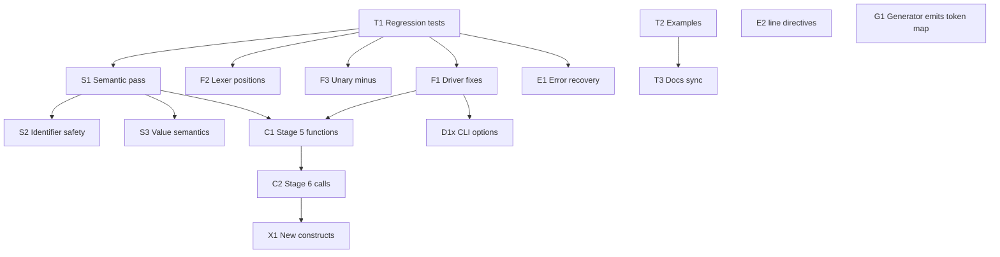

# FayZul Development Roadmap

Prioritized, dependency-aware plan based on the code as of 2026-10-09.
Every claim about current behavior was checked by reading the source and
compiling test programs with the current toolchain (g++ 16.1.0, MinGW-w64).
The C++ lowering proposals in §5 were compiled and run as standalone C++
files. They have not been implemented in the compiler.

## 1. Current status (verified)

| Stage | Feature | Status in code |
|---:|---|---|
| 1 | `difikhkhafa` print, string literals | Working |
| 2 | `rafkkhafo` variables, postfix `kefeBafarrafabafar`, `+ - * / %` with precedence | Working |
| 3 | `afagafar` / `wafarnafa`, 6 comparison words, `Afaur` / `Yafa` / `Nafain` | Working |
| 4 | `jafabTafak`, `Rufukufo`, `chafalnayDafo`, multi-argument print, `bafas` | Working |
| 5 | `kafaam` functions, `Wafapafas` return | Lexed only. The parser rejects them with "Unexpected token 'kafaam'". |
| 6 | Function calls | Not started (`NodeKind::CallExpr` placeholder only) |
| 7 | Better errors, parser recovery | Not started. The compiler stops at the first error. |

The README's Stage 1–4 "Complete" claim is accurate. Nothing in the
repository tests it: there is no `tests/` directory, no test script, and
the only example is `examples/hello.fz`, a triangle printer.

## 2. Documentation discrepancies

### 2.1 Conflicts in `Project-Submission-Document.md`

These conflict with the README, CLAUDE.md, or the code. Where the
question is the team's intent rather than a code fact, this document
**flags the conflict without choosing an answer**.

| # | Submission document says | Conflicts with | Verdict |
|---:|---|---|---|
| P1 | (line 13) "'Fay' and 'Zul' are drawn from the developers' names". It writes the name as فے کی بولی, with بولی meaning "language". | README and CLAUDE.md: Fay comes from *F ki Boli* (ف کی بولی) and Zul from فضول (*fazul*, "useless"). The Urdu spelling also differs: فے vs ف. | **Unresolved, and the team must decide.** The code cannot settle it. One account must be adopted everywhere before submission. |
| P2 | (line 39) "18 different relational/logical word-based operators" | `language-definition.json`, `operators.h`, and `TokenType` define **9**: 6 comparison (`bafaraHafai`, `chofotafaHafai`, `bafarrafabafarHafai`, `bafarafaYafaBafarrafabafarHafai`, `chofotafaYafaBafarrafabafarHafai`, `mufukhtafalafifHafai`) and 3 logical (`Afaur`, `Yafa`, `Nafain`). Even counting all 14 keywords as well gives 23, not 18. | **Incorrect.** Change it to 9. |
| P3 | (line 30) the layering "allowed independent unit-level testing of each stage". (line 143) "Stages 1–4 are fully implemented, **tested**, and documented." | The repository has no test files, test harness, or test script. The only `.fz` file is `examples/hello.fz`. | **Unsupported.** Remove the claim, or reword it as "manually tested with example programs" until T1 exists. |
| P4 | (§3.2.4) `Nafain` has the **highest** precedence (level 6, above `*`). | `Parser::parseLogicalNot` sits *between* `Afaur` and comparison. `Nafain 0 bafaraHafai 5` compiles to `(!(0 > 5))` and prints `1`. Under the documented table it would be `(!0) > 5`, which is `0`. The README precedence table matches the code. | **Incorrect.** Fix the table. |
| P5 | (line 39) "nested while loops with labelled-like jump targets" | Codegen emits plain `break;` / `continue;`. | **Overstated.** |
| P6 | (line 143) "five sequential … stages" | README and CLAUDE.md list 7 stages. | **Inconsistent.** |
| P7 | (line 17) "compiles cleanly to C++17" | See D4: generated programs are compiled in g++'s default mode, which is C++20 on this machine. | **Inaccurate** until F1 is done. |

### 2.2 Other discrepancies

| # | Where | Documented | Actual |
|---:|---|---|---|
| D1 | README, CLAUDE.md | F ki Boli example `dikha` → `difikkhafa` | The print keyword is spelled `difikhkhafa`. Either the example or the keyword is inconsistent. This needs a design decision. |
| D4 | README pipeline diagram | `g++ -std=c++17` compiles the generated program | `main.cpp` runs `g++ -o … …` with no `-std` flag. g++ 16.1's default is **C++20** (`__cplusplus == 202002L`), so generated programs are not C++17 today. |
| D5 | README "Error Reporting" | `Unexpected token 'xyz' (expected a statement)` | The real format is `Unexpected token '…' — expected a statement`. A bare identifier such as `xyz` goes to assignment parsing and fails with `Expected an expression but got ''`. The `[CodeGen Error]` example cannot occur with any input the parser accepts. |
| D6 | README delimiter table | `( )` used for "function calls" | Function calls are not implemented. |
| D7 | `ast.h` header comment | VarDecl, Assign, BinaryExpr, If, While, … are listed under "FUTURE NODES (stubs)" | All of them are implemented. |
| D8 | `ast.h`, `codegen.cpp` comments | `rafkkhafo x = 42;`, `x = 100;`, "right-hand side of '='" | This is the old infix syntax. `=` is now a lexer error. |
| D9 | `lexer.h` comment | `=` is a symbol token | `=` is rejected with `Unknown character '='`. |
| D10 | README, CLAUDE.md | Print semantics | Several behaviors are undocumented: booleans print as `1`/`0`, `Khafalafi` prints `nullptr`, and `bafas` anywhere in the argument list (even first) adds one newline at the end. The output uses `std::endl`, which also flushes. |
| D11 | CLAUDE.md "Project Structure" | Lists the core files | It leaves out `Project-Submission-Document.md`, `FayZul_Grammar.docx` (not reviewed here), `cppPractice/`, `.vscode/launch.json`, and `docs/`. |

## 3. Defects and risks found in code

**Correctness**

- **R1. No semantic analysis.** Undeclared variables, redeclarations in
  the same scope, `Rufukufo` outside a loop, and type mismatches pass
  the FayZul front end. They fail later in g++, which reports positions
  in `build/NAME.cpp`, not the `.fz` file.
- **R2. Identifiers pass straight into C++.** `rafkkhafo int 1 kefeBafarrafabafar;`
  produces invalid C++. Names like `std` or `cout` would collide the
  same way.
- **R3. `auto` typing gives C semantics.** A string literal becomes
  `const char*`, so `a + "x"` fails to compile. `"a" bafarrafabafarHafai "a"`
  compares pointers, and the result depends on how the compiler pools
  literals. `x 2.5 kefeBafarrafabafar` on an int variable silently
  truncates to `2`, and `7 / 2` is `3`.
- **R4. No unary minus.** `rafkkhafo x -5 kefeBafarrafabafar;` is a
  parse error. The workaround is `0 - 5`.
- **R5. Lexer column is off by one** for `Unknown character`. The
  character has already been consumed when the error is thrown, even
  though the comment says the column is rewound. "Unterminated string"
  errors report where the scan stopped, not where the string opened.

**Driver and tooling**

- **R6. Output ordering.** The compiler does not flush `std::cout`
  before `std::system()`. When stdout is piped, the program's output
  appears *before* the compiler's banner (seen in testing).
- **R7. Paths depend on the working directory.** `build/` is relative to
  the current directory, two `.fz` files with the same stem overwrite
  each other, and the compiler always prints the generated C++ and then
  runs the program. There are no CLI options.
- **R8. Manual vocabulary sync.** The generator does not emit
  `TokenType`, the lexer map, or `tokenTypeName`. The JSON `implemented`
  flag is not checked against the parser.
- **R9. Dead code.** `Parser::match`, `Parser::peek`,
  `Lexer::makeToken`, and `executablePath` in `main.cpp` are unused.

**Design risks for upcoming stages** (proposals in §5)

- **R10. Codegen puts everything in `main()`.** Functions must be
  emitted at namespace scope, before `main`.
- **R11. C++17 has no `auto` parameters.** `auto f(auto a)` is rejected
  under `-std=c++17 -pedantic-errors`; plain `-std=c++17` only warns
  (`-Wc++20-extensions`). Because g++ currently defaults to C++20 (D4), a
  naive `auto` lowering would appear to work today and then break once
  F1 pins `-std=c++17`.
- **R12. Grammar ambiguity between call and assignment statements.**
  `x (1) kefeBafarrafabafar;` (assign `(1)` to `x`) and `f(1);` (call
  `f`) begin with the same two tokens, `IDENTIFIER '('`.

## 4. Prioritized roadmap

Priorities: **P0** protects what already works, **P1** is required
before Stage 5, and **P2/P3** are the planned stages and their follow-ups.
"Depends on" lists items that must be done first.

| ID | Pri | Work item | Depends on | Addresses |
|---|---|---|---|---|
| T1 | P0 | Regression harness: `tests/` with `.fz` programs, expected stdout, and expected-error cases, plus a script that runs them all | – | No tests, P3 |
| T2 | P0 | Example programs for each Stage 1–4 feature (conditions, logic, break/continue, print/`bafas`) | – | Only one example |
| T3 | P0 | Docs sync: fix P2–P7 and D4–D11. **Team decision needed** on the name origin (P1) and on the `difikhkhafa` spelling (D1). | – | §2 |
| F1 | P0 | Driver fixes: flush before `system()`, pass `-std=c++17` to g++ | T1 | R6, D4, P7 |
| F2 | P1 | Lexer error positions: correct the column, report where the string opened | T1 | R5 |
| F3 | P1 | Unary minus in `parseLogicalNot`/a new unary level, `UnaryExprNode("-")` | T1 | R4 |
| S1 | P1 | Semantic pass between Parser and CodeGen: scoped symbol table, undeclared/redeclared names, `Rufukufo`/`chafalnayDafo` outside a loop | T1 | R1 |
| S2 | P1 | Identifier safety: mangle or reject C++ keywords and reserved names | S1 | R2 |
| S3 | P1 | Decide and implement value semantics: emit `std::string` for strings, define bool/null printing, numeric promotion rules | S1, design decision | R3, D10 |
| G1 | P2 | Generator also emits the keyword→`TokenType` table, or validates it | – | R8 |
| C1 | P2 | **Stage 5:** `FunctionDeclNode`, `ReturnStmtNode`; parser rules for `kafaam` and `Wafapafas`; template lowering and function hoisting (§5.1); return-consistency checks in S1 | F1, S1 | R10, R11 |
| C2 | P2 | **Stage 6:** `CallExprNode`, argument lists, the call-statement rule (§5.2), arity check in S1 | C1, S1 | R12 |
| E1 | P2 | **Stage 7a:** collect multiple diagnostics; panic-mode recovery that syncs on `;` and `}` | T1 | Stage 7 |
| E2 | P2 | **Stage 7b:** emit `#line` directives so g++ errors point at the `.fz` source | – | R1 (remaining) |
| D1x | P3 | CLI options (`-o`, `--emit-cpp`, `--no-run`), output paths not tied to the working directory | F1 | R7 |
| V1 | P3 | VS Code: hover also shows the "Reserved, not compiled yet" note that completions show | – | Editor polish |
| X1 | P3 | New constructs (input, for loops, arrays). Each needs an F ki Boli word chosen by the team; none has been invented here. | C2 | Future scope |

F1 is a dependency of C1 so that function lowering is developed against
real C++17, not the C++20 default (R11).

### Dependency order



## 5. Design proposals for Stages 5 and 6

These are recommendations, not implemented features. The FayZul surface
syntax below uses only the existing words `kafaam` and `Wafapafas`. It
follows the form already announced in `Project-Submission-Document.md`
§4.6: `kafaam <name>(<params>) { ... }`.

### 5.1 Untyped `kafaam` parameters in C++17 (R11)

**Options considered**

| Option | C++17 valid? | Recursion | Verdict |
|---|---|---|---|
| `auto f(auto a)` | No. It is a C++20 feature (error under `-pedantic-errors`). | – | Rejected |
| Generic lambdas `auto f = [](auto a){…};` inside `main` | Yes | Needs a Y-combinator or `std::function`. Mutual recursion is impractical. | Rejected |
| Add type annotations to FayZul | Yes | Yes | Needs new vocabulary, which is a language-design change. Not recommended now. |
| Runtime `Value` type (`std::variant`) for every variable | Yes | Yes | Also fixes R3, but rewrites all existing codegen. Possible later. |
| **One template parameter per FayZul parameter, deduced `auto` return** | **Yes** | **Yes, including mutual recursion** | **Recommended** |

**Recommended lowering** (verified with `g++ -std=c++17 -Wall -Wextra -pedantic-errors`):

```text
kafaam add(a, b) { Wafapafas a + b; }
kafaam greet() { difikhkhafa("salam", bafas); }
```

```cpp
// 1. Forward declarations for every function, emitted first
template<class T0, class T1> auto add(T0 a, T1 b);
template<class = void>       auto greet();

// 2. Definitions, hoisted out of main()
template<class T0, class T1> auto add(T0 a, T1 b) { return (a + b); }
template<class>              auto greet() { std::cout << "salam" << std::endl; }

// 3. Top-level statements stay inside main()
int main() { ... }
```

Rules for codegen and the semantic pass:

1. **Every function is a template**, including zero-parameter functions
   (`template<class = void>`). Instantiation is then deferred until
   `main`, so forward declarations plus deduced return types support
   recursion and mutual recursion in any source order. The test program
   ran `fact(5)` → 120, mutual `isEven`/`isOdd`, and `add(2, 0.5)` → 2.5.
2. **Hoisting:** `CodeGenerator::generate` makes two passes over
   `program.statements`. It emits `FunctionDeclNode`s (declarations, then
   definitions) before `int main()` and all other statements inside it.
3. **Scope decision:** hoisted functions cannot see variables declared
   by top-level `rafkkhafo` statements, because those are locals of
   `main`. Recommend that functions see only their parameters and their
   own locals, enforced in S1.
4. **Placement:** allow `kafaam` only at top level (S1 or parser
   error). C++ forbids nested function definitions.

**Limitations that S1 must turn into FayZul errors** (each one was
confirmed as a g++ error):

| Situation | g++ error today | Proposed FayZul rule |
|---|---|---|
| A recursive `Wafapafas` appears before any non-recursive one in the body | `use of 'auto fact(T0)' before deduction of 'auto'` | Require a base-case `Wafapafas` that comes earlier in source order. Document this as a language rule. |
| Different value types are returned, e.g. `Wafapafas n / 2.0;` and `Wafapafas 1;` | `inconsistent deduction for auto return type: 'double' and then 'int'` | The rule depends on the S3 numeric-promotion decision. Until then, report a FayZul error. |
| `Wafapafas;` and `Wafapafas expr;` in the same function | `inconsistent deduction … 'void' and then 'int'` | Report a FayZul error: a function either always returns a value or never does. |
| `Wafapafas` outside any function | `return` in `main`, which would silently end the program | Report a FayZul error. |

### 5.2 Telling `f(1);` apart from `x (1) kefeBafarrafabafar;` (R12)

**Facts verified in `parser.cpp`:**

- At statement start, `IDENTIFIER` always goes to `parseAssignStatement`.
  The target is taken with `consume()`, not `parsePrimary()`.
- Inside an expression, an `IDENTIFIER` immediately followed by `(` is
  never valid today, because juxtaposed operands are a parse error. So
  making `IDENTIFIER '(' args ')'` a call *inside expressions*
  (`parsePrimary`) changes the meaning of no program that compiles today.
  This covers cases such as `x f(1) kefeBafarrafabafar;`.
- `rafkkhafo f (1) kefeBafarrafabafar;` stays a declaration, because the
  name is read with `expect(Identifier)`.

The only real ambiguity is therefore **statement-initial
`IDENTIFIER '('`**.

**Recommended grammar**

```text
statement      → … | callStmt | assignStmt
callStmt       → IDENTIFIER '(' argList? ')' ';'
assignStmt     → IDENTIFIER expression ASSIGN ';'
argList        → expression (',' expression)*
primary        → … | IDENTIFIER '(' argList? ')'    // call expression
                   | IDENTIFIER
```

**Disambiguation rule** (deterministic, with bounded lookahead and no AST
backtracking):

> At statement start, if the current token is `IDENTIFIER` and the next
> token is `(`, scan forward to the matching `)` while counting paren
> depth. If the token after it is `;`, parse a **callStmt**. Otherwise
> parse an **assignStmt**.

Why this rule is sound:

- A callStmt must end in `)` `;`. An assignStmt must contain `ASSIGN`
  before its `;`, so it can never be `IDENTIFIER ( … ) ;`. The two forms
  cannot overlap.
- Worked cases:
  - `f(1);` → callStmt.
  - `x (1) kefeBafarrafabafar;` → `)` is followed by `ASSIGN`, so
    assignStmt with value `(1)`.
  - `x (1) + 2 kefeBafarrafabafar;` → assignStmt with value `(1) + 2`.
  - `x f(1) kefeBafarrafabafar;` → the second token is `IDENTIFIER`, so
    assignStmt with a call value.
- All existing assignment programs keep their meaning.
- Implementation: add a helper `bool Parser::isCallStatement() const`
  that uses `peek(offset)`, the currently unused helper (R9), plus one
  `case` in `parseStatement`. Stop the scan at `EndOfFile` so unbalanced
  parentheses reach the normal error path.

**Error-message consequence:** `f(1)` with a missing `;` falls into
assignStmt and reports "Expected 'kefeBafarrafabafar' …". Recommend that
`parseAssignStatement` add the hint "did you mean a call ending in
';'?" when the value expression is a bare parenthesized group.

**Alternatives rejected:**

- A dedicated call-statement keyword: it would invent vocabulary.
- Forbidding a parenthesized value right after the target: it would
  break the currently valid `x (1) kefeBafarrafabafar;`.
- Full backtracking: unnecessary, because the lookahead rule is exact.

## 6. Open design decisions

1. **Name origin (P1):** developers' names (submission document) or
   F ki Boli plus فضول (README and CLAUDE.md), and the Urdu spelling
   فے vs ف. This is the team's call. All documents must agree.
2. Canonical F ki Boli example and spelling of the print keyword (D1).
3. Whether to accept the template lowering (§5.1), including the
   base-case-first `Wafapafas` rule and the scope rule that functions
   cannot see top-level variables.
4. Whether to adopt the call-statement lookahead rule (§5.2).
5. String, boolean, and null semantics: what `Safach` prints, whether
   `Khafalafi` stays `nullptr`, how strings are compared, and how mixed
   numeric returns are promoted (R3, S3).
6. Words for any new construct (X1). These must follow the F ki Boli
   style and be chosen by the team, not invented ad hoc.

## 7. Working rules (from CLAUDE.md)

- Edit vocabulary only in `language/language-definition.json`, then run
  `node tools/generate-language.js`.
- Keep FayZul spellings out of grammar logic and `codegen.cpp`.
- Before each roadmap item, build with
  `g++ -std=c++17 -Wall -Wextra -o build/fayzul.exe src/main.cpp src/lexer.cpp src/parser.cpp src/codegen.cpp`
  and run the regression suite (once T1 exists).
