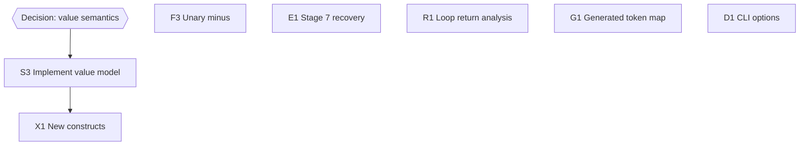

# FayZul Development Roadmap

Status as of 2026-10-09, verified against the source and by running
`node tests/run-tests.js` (80/80 passing) with g++ 16.1.0 (MinGW-w64).

## 1. Current status

| Stage | Feature | Status | Evidence |
|---:|---|---|---|
| 1 | `difikhkhafa` print, `bafas`, string literals | Complete | `tests/cases/stage1_print` |
| 2 | `rafkkhafo`, postfix `kefeBafarrafabafar`, arithmetic, precedence | Complete | `tests/cases/stage2_variables` |
| 3 | `afagafar` / `wafarnafa`, 6 comparison and 3 logical words | Complete | `tests/cases/stage3_conditionals` |
| 4 | `jafabTafak`, `Rufukufo`, `chafalnayDafo` | Complete | `tests/cases/stage4_loops` |
| 5 | `kafaam` functions, `Wafapafas` return | Complete | `tests/cases/stage5_functions`, `errors_semantic` |
| 6 | Calls, multiple arguments, recursion, mutual recursion | Complete | `tests/cases/stage5_functions` |
| 7 | Better errors and parser recovery | Partial | Semantic and mapped C++ errors done; recovery not started |

Test suite: 23 output tests, 55 error tests (25 syntax, 27 semantic,
3 translated C++), and 2 example smoke tests.

## 2. Work completed in this round

| Previous ID | Item | Result |
|---|---|---|
| T1 | Regression harness | `tests/run-tests.js` plus `tests/cases/`. The baseline suite was written and run *before* any compiler change. |
| F1 | Strict C++17 and output flushing | Generated C++ is compiled with `-std=c++17 -pedantic-errors`. The driver now flushes stdout before `std::system`. The suite caught the old reordering bug: all output tests failed on the baseline. |
| F2 | Lexer error positions | "Unknown character" now reports the character's own column, not the next one. "Unterminated string" reports where the string opens. |
| S1 | Semantic pass | New `src/semantic.{h,cpp}` checks undeclared and redeclared variables, self-initialization, break/continue outside loops, and all function rules. |
| S2 | Identifier safety | All FayZul names get an `fz_` prefix in C++, so `int`, `class`, `new`, and `main` work as FayZul names. |
| C1, C2 | Stages 5 and 6 | Functions, returns, calls, and call statements, using the template lowering in §3.1. |
| E2 | g++ errors at FayZul lines | The code generator keeps a C++-line → FayZul-line map. The driver prints `[C++ Error] Line N:` and translates the return-type mismatch message. This replaced the planned `#line` directives, which would have cluttered the printed C++. |
| T3 | Documentation sync | README, CLAUDE.md, this file, the mind map, and source comments now match the code. |

## 3. Design decisions made

### 3.1 Untyped parameters in C++17

The earlier proposal was plain templates with a deduced return type. It
was tested and found **not robust**. g++ rejected:

- a call with non-dependent arguments (`g()` or `h(2)`) inside a template, when the callee is defined later: `use of 'auto g()' before deduction of 'auto'`;
- recursion in a function that returns no value (`auto` deduction for `void`).

The adopted lowering, verified under `-std=c++17 -pedantic-errors -Wall -Wextra`:

```cpp
template<class FZ_CTX, class T0> auto fz_fact(T0 fz_n);          // forward declarations
template<class FZ_CTX>           void fz_salam();

template<class FZ_CTX, class T0> auto fz_fact(T0 fz_n) {           // definitions
    if ((fz_n <= 1)) { return 1; }
    return (fz_n * fz_fact<FZ_CTX>((fz_n - 1)));                   // dependent call
}
int main() { std::cout << fz_fact<void>(5) << std::endl; }
```

- **`FZ_CTX`:** every call inside a function passes the context parameter explicitly. That makes the call dependent, so it is resolved only when `main()` instantiates the function. By then every definition exists.
- **Return type:** functions without `Wafapafas <value>` are declared `void`, so they need no deduction.
- **What remains inherent to `auto` deduction:** the return type comes from the first `Wafapafas` reached. The semantic pass rejects any call that can recurse back into the function before a non-recursive `Wafapafas` appears, with a FayZul error. Returns of different types for the same call cannot be detected without a type checker. g++ reports them, and the driver translates the message into a FayZul one at the right line.

A dynamic `Value` runtime type would remove these restrictions. It was
rejected for now because it would change existing semantics such as
integer division and number printing.

### 3.2 Function scope

A function body sees only its parameters and its own locals. Top-level
variables are locals of `main()` in C++, so they are not visible inside
functions, and the semantic pass reports this with a dedicated message.
Functions, parameters, and variables share one namespace. `kafaam` is
allowed only at the top level, and calls may come before declarations.

### 3.3 Call vs. assignment

At statement start, `IDENTIFIER (` is a **call** when the `)` that
matches the first `(` is followed by `;`. Otherwise it is an
**assignment**.

- **No overlap:** an assignment always has `kefeBafarrafabafar` before its `;`, so the two forms cannot both match.
- **No meaning changes:** `IDENTIFIER (` inside an expression was always a syntax error, so making it a call changes no existing program. Existing tests such as `x (1) kefeBafarrafabafar;` still pass.
- **Malformed input gets targeted messages:** a missing `;` after a call, an unclosed `(`, and a trailing comma each have their own error, all covered in `tests/cases/errors_syntax/`.

### 3.4 Vocabulary documentation

The README and CLAUDE.md used to give the F ki Boli example as `dikha` →
`difikkhafa`, but the keyword is `difikhkhafa`. Both now describe
`difikhkhafa` as the F ki Boli form of `dikha`. No keyword spelling was
changed. `Project-Submission-Document.md` has been deleted, which removes
its conflicting name-origin and operator-count claims. The README account
(F ki Boli + فضول) is now the only one.

## 4. Known limitations (verified)

| # | Limitation | Example |
|---|---|---|
| L1 | A variable's type is fixed by its first value (`auto`). Decimals assigned to whole-number variables are truncated. | `x 2.5` on an int variable gives `2` |
| L2 | `/` on whole numbers is integer division | `7 / 2` is `3` |
| L3 | Strings are `const char*`: `+` is a `[C++ Error]`, and `==` compares addresses | `a + "y"` |
| L4 | Booleans print as `1`/`0` and act as numbers; `Khafalafi` prints `nullptr` | `1 + Safach` is `2` |
| L5 | All `Wafapafas` in a function must return the same type for a given call | `fact(2.5)` with `Wafapafas 1;` |
| L6 | No unary minus | write `0 - 5` |
| L7 | Only the first error is reported | – |
| L8 | Loops never count as "always returns" | add a final `Wafapafas` |
| L9 | `build/` is relative to the working directory, and the program always runs after compiling | – |
| L10 | Translating g++ messages depends on g++'s wording. Unrecognized messages are shown as-is with FayZul line numbers. | – |

## 5. Remaining roadmap

| ID | Pri | Work item | Depends on | Addresses |
|---|---|---|---|---|
| S3 | P1 | Value semantics: emit `std::string` for strings, decide bool/null printing and numeric promotion | design decision | L1–L5 |
| F3 | P1 | Unary minus: a new unary level emitting `UnaryExprNode("-")` | – | L6 |
| E1 | P2 | **Stage 7:** collect multiple diagnostics, with panic-mode recovery that syncs on `;` and `}` | – | L7 |
| R1 | P2 | Definite-return analysis for `jafabTafak (Safach)` loops without `Rufukufo` | – | L8 |
| G1 | P2 | Generator also emits the keyword→`TokenType` table (today `token.h` and the lexer map are maintained by hand) | – | Manual sync risk |
| D1 | P3 | CLI options (`-o`, `--emit-cpp`, `--no-run`), output paths not tied to the working directory | – | L9 |
| X1 | P3 | New constructs (input, for loops, arrays). Each needs an F ki Boli word chosen by the team. | S3 | Future scope |



Every item should start and end with `node tests/run-tests.js` passing,
and should add tests for its new behavior.

## 6. Decisions that still need the team

1. **Value semantics (S3):**
   - Should strings become real text values, with `+` concatenating and `bafarrafabafarHafai` comparing text?
   - Should booleans print as `Safach` / `Jhufoot`?
   - Should mixed whole/decimal returns promote to decimal?

   Each of these changes current output, so it needs an explicit decision.
2. **Top-level variables in functions:** they are currently not visible (§3.2). Allowing them would need either globals or explicit capture, which is a language-design change.
3. **F ki Boli derivation:** whether `difikhkhafa`, with its doubled `kh`, is the canonical F ki Boli form of `dikha`, and the general transformation rule to use for future words.
4. **Words for new constructs (X1):** these must be chosen by the team.
