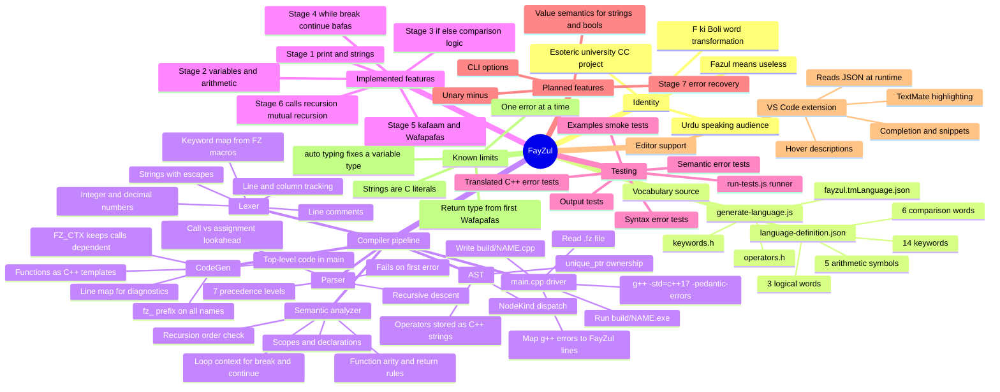
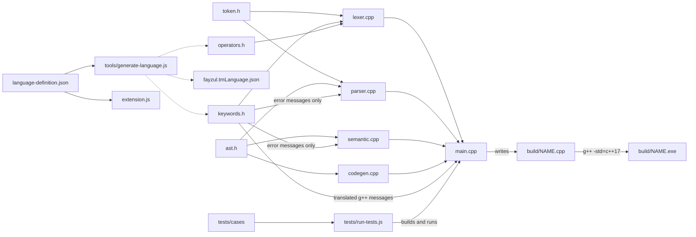

# FayZul Project Mind Map

Snapshot of the FayZul compiler as of 2026-10-09, checked against the
source in `src/`, `tools/`, `language/`, `tests/`, and `vscode-extension/`.
"Implemented" means there is a working Lexer → Parser → Semantic →
CodeGen path covered by the regression suite (`node tests/run-tests.js`,
80/80 passing).

## Mind map

## Component dependencies

The mind map cannot draw edges, so the build-time and run-time
dependencies are shown here. Solid arrows are `#include` or data reads;
dashed arrows are generated files.

## Notes for readers

- **Manual links that are not generated.** `TokenType` in `token.h`, the
  keyword map in `Lexer::Lexer`, and the `tokenTypeName` switch are
  maintained by hand. A new word in the JSON file does nothing until
  these are updated as well.
- **FayZul spellings outside the lexer** appear only in error messages
  via `FZ_*` macros (parser, semantic analyzer, driver). Grammar and
  semantic logic use `TokenType` values and AST nodes.
- **Codegen is free of FayZul words.** The parser converts operator
  words to C++ operator strings (`">"`, `"&&"`) before building the AST.
- **Functions** become C++17 function templates with a leading `FZ_CTX`
  parameter; see the roadmap §3.1 for why.

See [FayZul_Development_Roadmap.md](FayZul_Development_Roadmap.md) for
design decisions, limitations, and remaining work.
