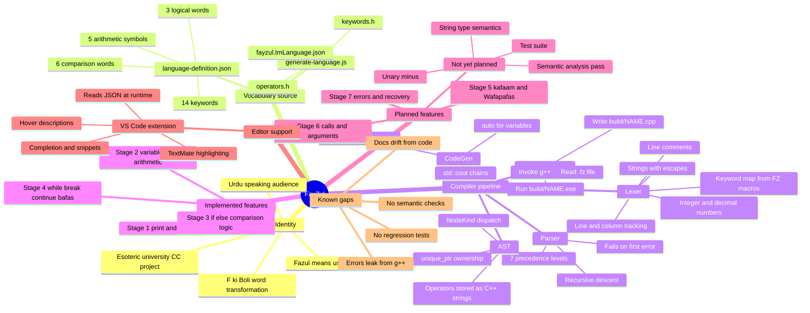
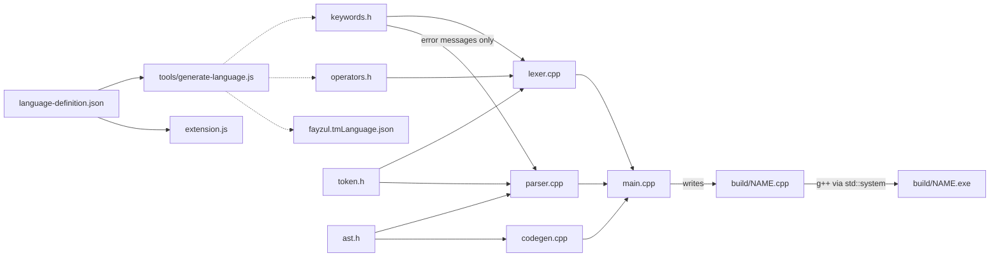

# FayZul Project Mind Map

Snapshot of the FayZul compiler as of 2026-10-09, checked against the
source in `src/`, `tools/`, `language/`, and `vscode-extension/`.
"Implemented" means there is a working Lexer → Parser → CodeGen path that
was exercised by compiling a `.fz` program. "Reserved" means the word is
lexed but the parser rejects it.

## Mind map

## Component dependencies

The mind map cannot draw edges, so the build-time and run-time
dependencies are shown here. Solid arrows are `#include` or data reads;
dashed arrows are generated files.

## Notes for readers

- **Manual links that are not generated.** `TokenType` in `token.h`, the
  keyword map in `Lexer::Lexer`, and the `tokenTypeName` switch are
  maintained by hand. A new word in the JSON file does nothing until
  these are updated as well.
- **Parser and FayZul spellings.** `parser.cpp` includes `keywords.h`
  only to put the current spelling into error messages. Its grammar
  logic uses `TokenType` values only.
- **Codegen is free of FayZul words.** The parser converts operator
  words to C++ operator strings (`">"`, `"&&"`) before building the AST.
- **Reserved, not implemented.** `kafaam` and `Wafapafas` produce tokens,
  and `NodeKind` has `FunctionDecl`, `ReturnStmt`, and `CallExpr`. There
  are no node structs, parser rules, or codegen for them yet.

See [FayZul_Development_Roadmap.md](FayZul_Development_Roadmap.md) for
priorities, discrepancies, and risks.